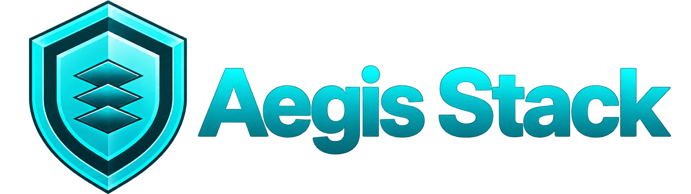
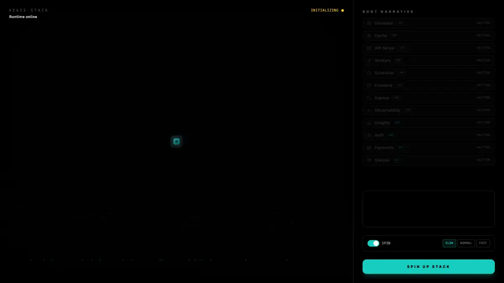
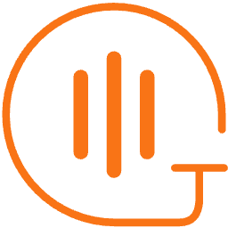
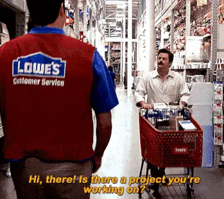

<div align="center" markdown>



*Inspired by the Neverwinter Nights toolset, Project Zero Dawn, and Dr. Wily.*

[](https://github.com/lbedner/aegis-stack/actions/workflows/ci.yml)
[](https://docs.aegis-stack.io)
[](https://pypi.org/project/aegis-stack/)
[](https://www.python.org/downloads/)
[](https://github.com/lbedner/aegis-stack/blob/main/LICENSE)
<br>
[](https://pypi.org/project/aegis-stack/)
[](https://pepy.tech/project/aegis-stack)
[](https://github.com/lbedner/aegis-stack/commits)
[](https://github.com/lbedner/aegis-stack/commits)
[](https://github.com/lbedner/aegis-stack/commits)
<br>
[](https://astral.sh)
[](https://github.com/copier-org/copier)
[](https://fastapi.tiangolo.com)
[![Flet](https://img.shields.io/badge/Flet-24292F?logo=data%3Aimage%2Fsvg%2Bxml%3Bbase64%2CPHN2ZyB4bWxucz0iaHR0cDovL3d3dy53My5vcmcvMjAwMC9zdmciIHhtbDpzcGFjZT0icHJlc2VydmUiIHdpZHRoPSIzMDdweCIgaGVpZ2h0PSIzMDdweCIgdmVyc2lvbj0iMS4xIiBzaGFwZS1yZW5kZXJpbmc9Imdlb21ldHJpY1ByZWNpc2lvbiIgdGV4dC1yZW5kZXJpbmc9Imdlb21ldHJpY1ByZWNpc2lvbiIgaW1hZ2UtcmVuZGVyaW5nPSJvcHRpbWl6ZVF1YWxpdHkiIGZpbGwtcnVsZT0iZXZlbm9kZCIgY2xpcC1ydWxlPSJldmVub2RkIiB2aWV3Qm94PSIwIDAgMjg1IDI4NSIgeG1sbnM6eGxpbms9Imh0dHA6Ly93d3cudzMub3JnLzE5OTkveGxpbmsiPjxnIGlkPSJMYXllcl94MDAyMF8xIj48cmVjdCBmaWxsPSJub25lIiB3aWR0aD0iMjg1IiBoZWlnaHQ9IjI4NSIgcng9IjkuMDMiIHJ5PSI4LjEyIi8%2BPHBhdGggZmlsbD0iI0VFMzE2NyIgZD0iTTM5LjI4IDE0NC43NGMtMC44NSwtMS41MiAtMC42NiwtMi42MSAwLjEsLTQuMTMgMzEuNDEsLTU4LjM2IDc4LjgxLC05NC4xNSAxMzguNTMsLTExOS43NSAyLjAzLC0wLjg2IDUuMDQsMS41MiA0LjMxLDMuNjUgLTguOSwyNS45MSAtMTUuMTgsNTEuMTMgLTE4LjgyLDc4LjIzIC0zLjMyLDI0Ljk3IC00LjI0LDUwLjc5IC0wLjg3LDc3Ljc3IDMuNTYsMzAuNTkgMTAuODgsNTUuOTkgMTkuNjgsODMuMzYgMC45OCwzLjA1IC0yLjE0LDQuNDMgLTQuNTEsMy4yNiAtNjIuMTksLTMwLjYxIC0xMDkuMzMsLTcwLjY1IC0xMzguNDIsLTEyMi4zOXoiLz48cGF0aCBmaWxsPSIjMDA5OERBIiBmaWxsLW9wYWNpdHk9IjAuNjM5MjE2IiBkPSJNMjI0LjUzIDE5OC41OWMtMzQuMzksLTEwLjc5IC02NS4xNSwtMjkuMDYgLTkyLjQsLTUzLjIgLTEuODIsLTEuNjIgLTEuNjEsLTMuODcgMC4wMywtNS40NCAyNy4wNywtMjUuODggNTcuNzksLTQ2LjE5IDkxLjc0LC02MC41NiAyLjk5LC0xLjI3IDUuNDUsMS4yIDQuNTYsNC42MiAtOS42MiwzNi45MSAtMTEuNzQsNzMuMzkgMC4xMywxMDkuOTUgMC45OCwzLjA1IC0xLjQ3LDUuNDQgLTQuMDYsNC42M3oiLz48cGF0aCBmaWxsPSIjNUFCQUU3IiBkPSJNMjI0LjUzIDE5OC41OWMtMjIuNjQsLTcuMSAtNDMuNzEsLTE3LjQ1IC02My4yNCwtMzAuNTggLTEuMzUsLTIwLjkgLTEuNDcsLTMwLjIgMC43MywtNTMuMjYgMTkuMTksLTE0LjIyIDM5Ljg2LC0yNi4wNCA2MS44OCwtMzUuMzYgMi45OSwtMS4yNyA1LjQ1LDEuMiA0LjU2LDQuNjIgLTkuNjIsMzYuOTEgLTExLjc0LDczLjM5IDAuMTMsMTA5Ljk1IDAuOTgsMy4wNSAtMS40Nyw1LjQ0IC00LjA2LDQuNjN6Ii8%2BPC9nPjwvc3ZnPg%3D%3D)](https://flet.dev)
[](https://htmx.org)
[](https://www.langchain.com)
[](https://www.postgresql.org)
[](https://pydantic.dev/docs/)

## Full-stack Python apps that know what they are.

</div>

Aegis Stack gives you a complete FastAPI app, wired and running: API, workers, scheduler, database, auth and AI, with plugins for anything else. Alongside it is [the Twin](https://docs.aegis-stack.io/overseer/twin/), a model of that app taken from its code and its live state. [Overseer](https://docs.aegis-stack.io/overseer/) shows it live and lets you operate it, [Illiana](https://docs.aegis-stack.io/services/ai/illiana/) explains it, and CI catches changes that break its rules, whether you wrote them or your agents did.


<!-- cards -->
<table>
<tr>
<td width="50%" valign="top" markdown>

#### Build

**An app.** Build from a [blueprint](https://docs.aegis-stack.io/cli-reference/#aegis-blueprints) or pick your pieces. Add or remove them later; your changes are merged, not overwritten.

</td>
<td width="50%" valign="top" markdown>

#### Ship

**A server.** One command, or one button in Overseer, [provisions a server](https://docs.aegis-stack.io/deployment/cloud/) in your own Hetzner or DigitalOcean account, adds HTTPS, and deploys. The server, the bill, and the data stay yours.

</td>
</tr>
<tr>
<td width="50%" valign="top" markdown>

#### See

**A control plane.** A live map of your system, from the whole stack down to a single function, with errors, deploys, jobs, resources, and cost on the same map. See [Overseer](https://docs.aegis-stack.io/overseer/). The same data is in your app's CLI and, for your agents, over MCP.

</td>
<td width="50%" valign="top" markdown>

#### Ask

**An operator, if you want one.** Talk to [Illiana](https://docs.aegis-stack.io/services/ai/illiana/) or type. She reads that map, answers with diagrams instead of guesses, and reviews every pull request against the system's rules.

</td>
</tr>
</table>
<!-- /cards -->

### What you could build

Each is `uvx aegis-stack init my-app` with:

| Build | With |
|---|---|
| [A SaaS MVP with billing](https://docs.aegis-stack.io/services/payment/) | `-s auth,payment -c database,htmx,worker` |
| [A finance app with an MCP server](https://docs.aegis-stack.io/services/finance/) | `-b finance -c database,scheduler,worker,mcp` |
| [A voice agent for your meetings](https://docs.aegis-stack.io/services/meetings/) | `-s "meetings,ai[sqlite,voice]"` |
| [A document vault, read by AI](https://docs.aegis-stack.io/services/documents/) | `-s auth,documents,ai -c database,storage,worker` |
| [A local AI app on Ollama](https://docs.aegis-stack.io/components/inference/) | `-s "ai[ollama]"` |

<details class="more" markdown>
<summary>5 more</summary>

| Build | With |
|---|---|
| [Email, SMS and calls from your app](https://docs.aegis-stack.io/services/comms/) | `-s comms -c worker` |
| [A Markdown blog with an editor](https://docs.aegis-stack.io/services/blog/) | `-s blog` |
| [A tracker for posts on your topic](https://docs.aegis-stack.io/services/research/) | `-s research -c database,scheduler` |
| [Adoption analytics](https://docs.aegis-stack.io/services/insights/) | `-s "insights[github,pypi]"` |
| [Background jobs at scale](https://docs.aegis-stack.io/components/worker/) | `-c worker,scheduler` |

</details>

### Running on it

| Live | What it is |
|---|---|
| **[Aegis Pulse](https://pulse.aegis-stack.io/)** | Package analytics with honest decomposition (total, filtered, human) |
| **[Sector 7G](https://sector-7g.dev/dashboard/)** | Millions of tasks on a single $5 VPS, zero restarts |
| **[NWVault Revival](http://167.99.48.44/)** | A searchable archive of the original Neverwinter Vault (2002-2014), built in 24 hours |

## Quick Start

```bash
uvx aegis-stack init my-app
```

`init` opens a full-screen guided setup that walks through every component and service with explanations. Prefer the classic one-line prompts? Pass `--quick`.

<details>
<summary><strong>More examples</strong></summary>

```bash
# Skip the guided setup, use the classic one-line prompts
uvx aegis-stack init my-app --quick

# Add user authentication out of the box
uvx aegis-stack init user-app --services auth

# Add background processing + scheduling
uvx aegis-stack init task-processor --components scheduler,worker

# Everything wired up at init
uvx aegis-stack init full-app --services auth,payment,comms --components worker,scheduler
```

</details>

> **CLI in 9 languages:** English, German, Spanish, French, Japanese, Korean, Russian, Simplified Chinese, Traditional Chinese. Run e.g. `uvx aegis-stack --lang zh init my-app`, or set `AEGIS_LANG=zh`.

**Installation alternatives:** See the [Installation Guide](https://docs.aegis-stack.io/installation/) for `uv tool install`, `pip install`, and development setup.

## Customizing Your Stack



**Components** are infrastructure pieces (database, workers, scheduler, cache). **Services** are business capabilities (auth, AI, payments, comms).

**Don't worry about what you pick today.** Add anything later with a single command and remove what you outgrow. Where a change touches files you've edited, your edits are merged in, and anything that can't merge cleanly is marked for you to review.

```bash
# Monday: Ship MVP
aegis init my-app

# Week 3: Add scheduled reports
aegis add scheduler --project-path ./my-app

# Month 2: Need async workers
aegis add worker --project-path ./my-app

# Month 6: Scheduler not needed
aegis remove scheduler --project-path ./my-app

# Stay current with template improvements
aegis update
```

See **[Evolving Your Stack](https://docs.aegis-stack.io/evolving-your-stack/)** for the complete guide.

### Components

<!-- aegis:components -->
| Component | What you get | |
|---|---|---|
| **[Backend](https://docs.aegis-stack.io/components/backend/)** | FastAPI on uvicorn or granian, lifecycle hooks, in-memory request metrics, API load testing for every route |  |
| **[CLI](https://docs.aegis-stack.io/cli-reference/)** | Typer, first-class system interface |  |
| **[Frontend](https://docs.aegis-stack.io/components/frontend/)** | Flet, ships with the Overseer system dashboard |  |
| **[Browser](https://docs.aegis-stack.io/components/browser/)** | Remote Chromium in its own container, driven over Playwright: JavaScript pages, sign-ins, a bot that joins a meeting |  |
| **[Database](https://docs.aegis-stack.io/components/database/)** | Postgres (self-hosted or Neon serverless) or SQLite + SQLModel ORM |  |
| **[Deploy](https://docs.aegis-stack.io/components/deploy/)** | Deployment target (Docker Compose), read by the Overseer |  |
| **[Inference](https://docs.aegis-stack.io/components/inference/)** | Local AI models via Ollama, speech via Kokoro |  |
| **[Ingress](https://docs.aegis-stack.io/components/ingress/)** | Traefik v3 reverse proxy with TLS |  |
| **[MCP](https://docs.aegis-stack.io/components/mcp/)** | Serves the app's own tools to Claude Desktop, Claude Code or a local model over MCP: the tools you grant, never a write |  |
| **[Observability](https://docs.aegis-stack.io/components/observability/)** | Pydantic Logfire tracing + metrics + logging |  |
| **[Redis](https://docs.aegis-stack.io/components/redis/)** | Redis for caching, sessions, pub/sub |  |
| **[Scheduler](https://docs.aegis-stack.io/components/scheduler/)** | APScheduler with persistent jobs |  |
| **[Secrets](https://docs.aegis-stack.io/components/secrets/)** | Encrypted credential store: keys set while the app runs, checked with the provider on paste, never shown again |  |
| **[Storage](https://docs.aegis-stack.io/components/storage/)** | S3 object storage for the files an app keeps, SeaweedFS in dev |  |
| **[Web Frontend](https://docs.aegis-stack.io/components/web-frontend/)** | Server-rendered pages at `/`: Jinja2 + htmx + Alpine, Tailwind/DaisyUI styling |  |
| **[Worker](https://docs.aegis-stack.io/components/worker/)** | Pluggable Arq, Taskiq, or Dramatiq |  |
<!-- /aegis:components -->

[Components Docs →](https://docs.aegis-stack.io/components/)

### Services

<!-- aegis:services -->
| Service | What you get | |
|---|---|---|
| **[AI](https://docs.aegis-stack.io/services/ai/)** | Conversational agents, RAG, model catalog, TTS and STT (PydanticAI / LangChain across 7 providers) |  |
| **[Auth](https://docs.aegis-stack.io/services/auth/)** | Persistent sessions with refresh-token rotation, GitHub/Google sign-in, RBAC, multi-tenant Organizations |  |
| **[Blog](https://docs.aegis-stack.io/services/blog/)** | Markdown publishing with drafts, tags, and an Overseer editor |  |
| **[Comms](https://docs.aegis-stack.io/services/comms/)** | Transactional email (Resend) + SMS / voice (Twilio) |  |
| **[Documents](https://docs.aegis-stack.io/services/documents/)** | Content-addressed document store, deduped, with page-addressed extraction |  |
| **[Finance](https://docs.aegis-stack.io/services/finance/)** | Personal finance aggregation (accounts, transactions, net worth, import) |   |
| **[Insights](https://docs.aegis-stack.io/services/insights/)** | Adoption metrics across GitHub, PyPI, Plausible, Reddit |  |
| **[Meetings](https://docs.aegis-stack.io/services/meetings/)** | A bot that joins Google Meet as its own agent: transcript, notes, threads, people, what keeps coming up, joined from its calendar |   |
| **[Payment](https://docs.aegis-stack.io/services/payment/)** | Stripe checkout, subscriptions, refunds, disputes |  |
| **[Research](https://docs.aegis-stack.io/services/research/)** | Outside posts and threads, collected by saved searches |  |
<!-- /aegis:services -->

[Services Docs →](https://docs.aegis-stack.io/services/)

### Plugins

What the built-in services don't cover can come from a plugin: a Python package that adds routes, tables, a CLI and a dashboard card, and goes in and out the same way (`aegis add <name>`, `aegis remove <name>`). Browse them at [aegis-stack.io/plugins](https://aegis-stack.io/plugins) or with `aegis plugins search`, and start your own with `aegis plugins create`.

[Plugins Docs →](https://docs.aegis-stack.io/plugins/)

## Deploy and back up

- **Provision** a server in your own Hetzner or DigitalOcean account, price shown first, with `aegis deploy-provision` or from Overseer > Deployments. HTTPS comes with it.
- **Deploy** to any VPS over SSH with `aegis deploy`: rsync and Docker, no PaaS lock-in.
- **Back up** before every deploy, roll back on a failed health check, keep encrypted nightly copies off the server, and run a drill that proves they restore.
- **CI** on every push: GitHub Actions for lint, types and tests, CodeQL scanning, and an optional continuous-deploy workflow.

[Deployment Docs →](https://docs.aegis-stack.io/deployment/)

## Integrations

Aegis Stack is the orchestration layer. Services and components wire into best-in-class tools you already trust, so you keep your vendor choices and your data.

<table width="100%">
<tr>
<td align="center" width="16.66%"><a href="https://www.anthropic.com"><picture><source media="(prefers-color-scheme: dark)" srcset="docs/images/integrations/anthropic-dark.svg"></picture></a></td>
<td align="center" width="16.66%"><a href="https://astral.sh"><picture><source media="(prefers-color-scheme: dark)" srcset="docs/images/integrations/astral-dark.svg"></picture></a></td>
<td align="center" width="16.66%"><a href="https://www.trychroma.com"><picture><source media="(prefers-color-scheme: dark)" srcset="docs/images/integrations/chromadb-dark.svg"></picture></a></td>
<td align="center" width="16.66%"><a href="https://dramatiq.io"><picture><source media="(prefers-color-scheme: dark)" srcset="docs/images/integrations/dramatiq-dark.png"></picture></a></td>
<td align="center" width="16.66%"><a href="https://fastapi.tiangolo.com"></a></td>
<td align="center" width="16.66%"><a href="https://flet.dev"></a></td>
</tr>
<tr>
<td align="center" width="16.66%"><a href="https://github.com"><picture><source media="(prefers-color-scheme: dark)" srcset="docs/images/integrations/github-dark.svg"></picture></a></td>
<td align="center" width="16.66%"><a href="https://www.google.com"></a></td>
<td align="center" width="16.66%"><a href="https://github.com/remsky/Kokoro-FastAPI"></a></td>
<td align="center" width="16.66%"><a href="https://www.langchain.com"></a></td>
<td align="center" width="16.66%"><a href="https://neon.tech"></a></td>
<td align="center" width="16.66%"><a href="https://ollama.com"><picture><source media="(prefers-color-scheme: dark)" srcset="docs/images/integrations/ollama-dark.svg"></picture></a></td>
</tr>
<tr>
<td align="center" width="16.66%"><a href="https://plausible.io"></a></td>
<td align="center" width="16.66%"><a href="https://www.postgresql.org"></a></td>
<td align="center" width="16.66%"><a href="https://pydantic.dev"></a></td>
<td align="center" width="16.66%"><a href="https://www.reddit.com"></a></td>
<td align="center" width="16.66%"><a href="https://redis.io"></a></td>
<td align="center" width="16.66%"><a href="https://resend.com"><picture><source media="(prefers-color-scheme: dark)" srcset="docs/images/integrations/resend-dark.svg"></picture></a></td>
</tr>
<tr>
<td align="center" width="16.66%"><a href="https://www.sqlite.org"></a></td>
<td align="center" width="16.66%"><a href="https://stripe.com"></a></td>
<td align="center" width="16.66%"><a href="https://supabase.com"></a></td>
<td align="center" width="16.66%"><a href="https://taskiq-python.github.io"><picture><source media="(prefers-color-scheme: dark)" srcset="docs/images/integrations/taskiq-dark.svg"></picture></a></td>
<td align="center" width="16.66%"><a href="https://traefik.io"></a></td>
<td align="center" width="16.66%"><a href="https://www.twilio.com"></a></td>
</tr>
<tr>
<td align="center" width="16.66%"><a href="https://typer.tiangolo.com"><picture><source media="(prefers-color-scheme: dark)" srcset="docs/images/integrations/typer-dark.svg"></picture></a></td>
</tr>
</table>

## For The Veterans



No reinventing the wheel. It's FastAPI, SQLModel, Pydantic and the rest of the tools you already know, wired together and ready to compose.

No custom abstractions or proprietary framework to learn. Once your stack is generated, it's your code: build it however you want. The Twin reads the code as it is; it doesn't ask you to write it a special way.

Aegis gets out of your way so you can get started.
