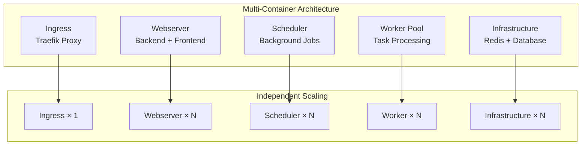

# Components Overview

Components are the **infrastructure building blocks** of your Aegis Stack application. Each component provides a specific capability like API serving, background tasks, or data persistence.

!!! info "Components vs Services"
    **Components** = Infrastructure capabilities (database, workers, scheduling)
    **Services** = Business functionality (auth, AI, comms, insights)

    See **[Services Overview](../services/index.md)** for business-level features.

## Evolving Your Stack

**Your choices aren't permanent.** Components can be added or removed as your requirements change.

Unlike most starters that lock you in at `init`, Aegis Stack lets you evolve:

- **Add components**: `aegis add scheduler --project-path ./my-api`
- **Remove components**: `aegis remove scheduler --project-path ./my-api`
- **Update templates**: Stay current with upstream improvements

For complete workflows with real-world examples, see **[Evolving Your Stack →](../evolving-your-stack.md)**

## Components

<!-- aegis:components -->
| Component | What you get | |
|---|---|---|
| **[Backend](https://docs.aegis-stack.io/components/backend/)** | FastAPI on uvicorn or granian, lifecycle hooks, in-memory request metrics, API load testing for every route |  |
| **[CLI](https://docs.aegis-stack.io/cli-reference/)** | Typer, first-class system interface |  |
| **[Frontend](https://docs.aegis-stack.io/components/frontend/)** | Flet, ships with the Overseer system dashboard |  |
| **[Browser](https://docs.aegis-stack.io/components/browser/)** | Remote Chromium in its own container, driven over Playwright: JavaScript pages, sign-ins, a bot that joins a meeting |  |
| **[Database](https://docs.aegis-stack.io/components/database/)** | Postgres (self-hosted or Neon serverless) or SQLite + SQLModel ORM |  |
| **[Deploy](https://docs.aegis-stack.io/components/deploy/)** | Deployment target (Docker Compose), read by the Overseer |  |
| **[Inference](https://docs.aegis-stack.io/components/inference/)** | Local AI models via Ollama |  |
| **[Ingress](https://docs.aegis-stack.io/components/ingress/)** | Traefik v3 reverse proxy with TLS |  |
| **[MCP](https://docs.aegis-stack.io/components/mcp/)** | Serves the app's own tools to Claude Desktop, Claude Code or a local model over MCP: the tools you grant, never a write |  |
| **[Observability](https://docs.aegis-stack.io/components/observability/)** | Pydantic Logfire tracing + metrics + logging |  |
| **[Redis](https://docs.aegis-stack.io/components/redis/)** | Redis for caching, sessions, pub/sub |  |
| **[Scheduler](https://docs.aegis-stack.io/components/scheduler/)** | APScheduler with persistent jobs |  |
| **[Secrets](https://docs.aegis-stack.io/components/secrets/)** | Encrypted credential store: keys set while the app runs, checked with the provider on paste, never shown again |  |
| **[Storage](https://docs.aegis-stack.io/components/storage/)** | S3 object storage for the files an app keeps, SeaweedFS in dev |  |
| **[Web Frontend](https://docs.aegis-stack.io/components/web-frontend/)** | Server-rendered pages at `/`: Jinja2 + htmx + Alpine, Tailwind/DaisyUI styling |  |
| **[Worker](https://docs.aegis-stack.io/components/worker/)** | Pluggable Arq, Taskiq, or Dramatiq |  |
<!-- /aegis:components -->

## Component Deployment

Understanding how components deploy and scale is crucial for architectural decisions:

**Multi-Container Architecture:** Each component runs in its own Docker container (via docker-compose) for isolation and maintainability.

**Backend + Frontend Container:** FastAPI serves the Flet UI as an integrated web app - this is an architectural choice, not a limitation.

**Independent Scaling:** Each service can be scaled separately based on demand using Docker Compose replicas or orchestration tools.

!!! tip "Component Composition"
    Components can be combined to enable different capabilities. For detailed patterns on how components integrate with services and each other, see the **[Integration Patterns Reference](../integration-patterns.md)**.

**Individual components combine to form your complete application.** Database + Scheduler + Worker + Auth + AI = A unified, production-ready system.
