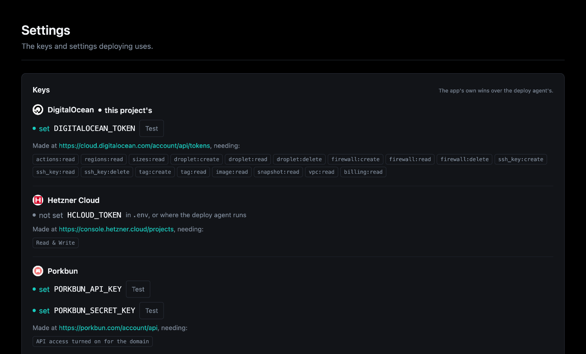

# Cloud accounts and keys

Making a server needs a cloud provider's token; putting your own domain on it
needs your DNS provider's keys. A server you already have needs neither, only
SSH.

## The keys

| Provider | For | Variable | Made at | Needs |
|----------|-----|----------|---------|-------|
| Hetzner Cloud | Servers | `HCLOUD_TOKEN` | [console.hetzner.cloud/projects](https://console.hetzner.cloud/projects) | Read & Write |
| DigitalOcean | Servers | `DIGITALOCEAN_TOKEN` | [cloud.digitalocean.com/account/api/tokens](https://cloud.digitalocean.com/account/api/tokens) | The scopes below |
| Porkbun | DNS | `PORKBUN_API_KEY`, `PORKBUN_SECRET_KEY` | [porkbun.com/account/api](https://porkbun.com/account/api) | API access turned on for the domain (its details page) |
| Cloudflare | DNS | `CLOUDFLARE_API_TOKEN` | [dash.cloudflare.com/profile/api-tokens](https://dash.cloudflare.com/profile/api-tokens) | `Zone:Zone:Read`, `Zone:DNS:Edit` on the zone that owns the name |

A DigitalOcean token is a custom-scoped one, with:

```
actions:read   regions:read   sizes:read
droplet:create droplet:read   droplet:delete
firewall:create firewall:read firewall:delete
ssh_key:create ssh_key:read   ssh_key:delete
tag:create     tag:read
image:read     snapshot:read  vpc:read   billing:read
```

`droplet:read` lets Overseer list what the account runs, and `billing:read`
this month's spend; without one, the page says which to add.

A Hetzner token can create and delete every server in its project, so make one
in a project dedicated to this app.

## Where to set them



- **Overseer > Deployments > Settings**: each key beside where the provider
  makes it and what it needs, with **Test** to check it and **Replace** to
  change it. The keys this project deploys with are marked "this project's".
- **Overseer > Secrets**, with the [secrets component](../components/secrets/index.md).
- **`.env`**.
- **The environment** of the shell or runner: an exported variable where the
  agent or the CLI runs works too (for CI, say).

The app's own (Settings, Secrets, `.env`) wins over one exported where the
agent runs. The CLI reads them from the environment at call time.

## How a token is handled

A token is a secret like the app's other credentials:

- **Overseer** sends it with the one request that needs it (the provider's
  sizes and regions, a new server, a destroy), beside its arguments rather
  than in them, so it is never audited or shown.
- **The agent** hands it to the command in its environment, masks it in the
  output, and keeps it nowhere. A DNS provider's keys travel the same way with
  a new server on a domain and its destroy; only a DNS provider's own
  variables are accepted (anything else, such as `PATH`, is refused).
- **The CLI** never stores or prints it (at most the last four characters are
  shown).

## Making and removing a server

```bash
aegis deploy-provision                                  # Hetzner, cx23 in nbg1
aegis deploy-provision --provider digitalocean          # s-1vcpu-2gb in tor1
aegis deploy-provision --size cx33 --region fsn1
aegis deploy-provision --domain app.example.com --dns porkbun
aegis deploy-destroy
```

The server boots with the project's `scripts/server-setup.sh` as cloud-init, so
it arrives with Docker and the firewall ready. On DigitalOcean the droplet also
gets a cloud firewall allowing only SSH, HTTP and HTTPS in: Docker-published
ports bypass the server's own ufw, so the firewall outside the droplet is the
one that holds.

Every resource is recorded under `provision:` in `.aegis/deploy.yml` the moment
it exists. If a later step fails, the command lists what was created and offers
to delete it; run it again to resume instead. `aegis deploy-destroy` deletes
the server, its DNS record, its cloud firewall and the SSH key provisioning
uploaded, after you type the server's name to confirm.

All options: [`aegis deploy-provision`](../cli-reference.md#aegis-deploy-provision),
[`aegis deploy-destroy`](../cli-reference.md#aegis-deploy-destroy).
