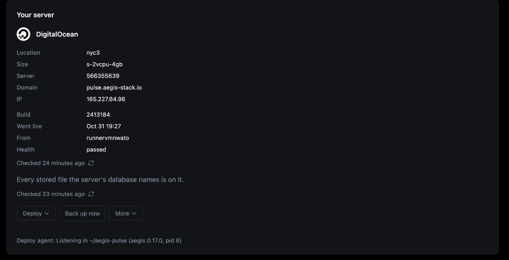
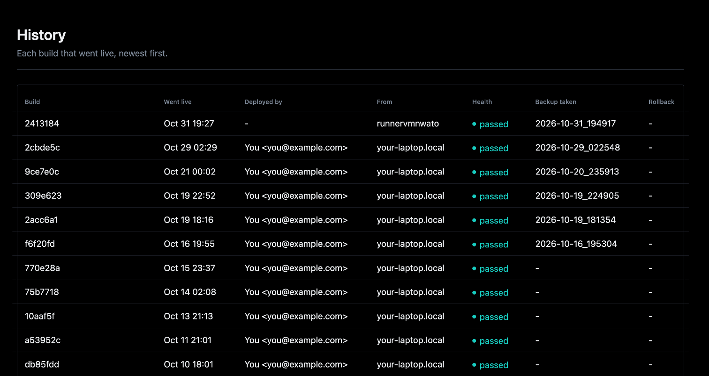
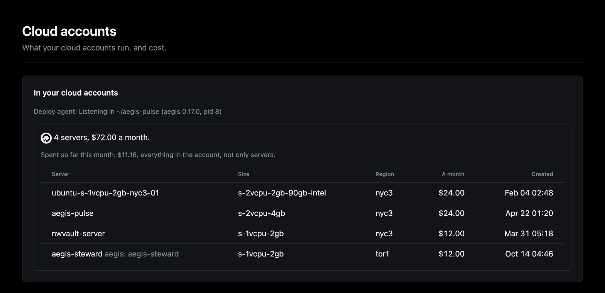

# From Overseer

With the htmx frontend and Redis, Overseer > Deployments on your dev build does
everything the CLI does, from the page: a new server (a size and region picked
from what the provider sells, its price typed back to confirm), deploy, back
up, list backups, rehearse a restore, roll back, destroy.

Until there is a server it walks you there in steps (the agent, where: a
provider's token or a server of your own, then the server), each read from what
is already true. After, it shows the server and what can be done to it. Each
action is audited, and its output streams under Deployments > Jobs.

| Section | What it shows |
|---------|---------------|
| Overview | The server and its actions, or the steps to one |
| New server | Size and region at their price, and whether the stack fits |
| Jobs | Every action asked, its output streamed as it runs |
| History | Each build that went live, then everything else done to the server |
| Backups | The backups on the server, the off-site copy and the last restore drill |
| Cloud accounts | What each account already runs, and what it costs a month |
| Settings | The provider and DNS keys ([Cloud accounts and keys](cloud.md)), and `.aegis/deploy.yml` |

## The deploy agent

The agent that runs the actions, `aegis deploy-agent`, is the dev stack's
`deploy-agent` service: `make serve` starts and stops it with the rest, compose
restarts it if it dies, and `docker compose logs deploy-agent` shows what it
did. It is never on the server.

The service is built on the aegis this project pins, so `aegis update` brings a
new one. It drives your machine's Docker, so it sees the checkout and a temp
directory of its own at their own paths, and it signs with your machine's
ssh-agent, never a key file: `make serve` adds your key to the agent when it
holds none (`ssh-add`, once per login; on macOS the passphrase is kept in the
Keychain). Off Docker Desktop, set `DEPLOY_AGENT_SSH_SOCK` to your agent's
socket.

`AEGIS_STACK_SOURCE` names a checkout of aegis to run instead: the service runs
it editable, each command on the code as it is, and the agent restarts itself
on it once idle. A stack generated from a checkout (`aegis init --dev`) gets
that checkout without asking, as the pinned release may not have the agent its
templates expect. Both are read by compose, not the app, so set them in the
shell (`DEPLOY_AGENT_SSH_SOCK=... make serve`), never in `.env`: the app
refuses to start on a key it does not know. With the stack started another way,
run `aegis deploy-agent` in the project directory yourself.

**Why a separate runner:** every step needs what the app's container does not
have and should not hold (the aegis CLI, the working tree it ships, your SSH
key, the host's Docker). So Overseer only asks, through the project's Redis,
and `aegis deploy-agent` runs the same commands you would type, with the key
staying in your machine's ssh-agent. A deployed server's Overseer offers no
deploy actions: redeploy from the dev Overseer or [from CI](ci.md).

## A new server

The sizes and regions come from the provider, through the agent, and are kept
in Redis for an hour, so the form offers only what can be created and where, at
its price. The agent prices the server again before creating it, and refuses
if the price has changed since.

Beside the price, **Will it fit?** puts the stack against the size picked: its
production services' memory (in use now, and their limits), CPU limits and
disk (images and data), measured by the agent on your machine, each bar toned
and saying why.

**Cloud accounts** shows what each account already runs: its servers with what
each costs a month (aegis's own marked), the total with the new one, and on
DigitalOcean this month's spend. Listing needs the token's `droplet:read`
scope, and the spend `billing:read`; without one, the page says which to add.

The Flet dashboard shows the commands only.
