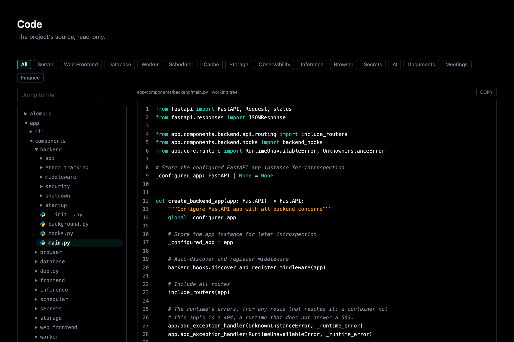

# Code

Open **Code** at `/overseer/code` to browse the project's source, read-only.
The tree on the left holds its folders and files. Click a file to open it
beside the tree, highlighted, with line numbers. Only the file pane changes, so
the tree keeps its scroll and the folders you opened. The address names the
file (`/overseer/code?file=app/components/backend/main.py`), and every line has its own anchor
(`#L-42`), so a link can land on a line.

Everything else in Overseer that points at code lands here: an error's frames
on [Errors](logs-and-errors.md#errors), a traceback on Logs, a route's dry path
and a replayed request's hops.

## Following a name

Click a name in a Python file and a small panel opens right beside it: where
the name is defined and every line that names it, each a link. Click
elsewhere or press Esc to close it. The index reads the source with
`ast` (nothing is imported): a name defined at a module's top level, or
imported, resolves, directly or through its module (`store.put`); one reached
through an object (`self.store.put`), and a library's, do not. Opening Code
reads the source in the background, so the first click answers as fast as the
rest.

## Narrowing the tree

The chips above the tree narrow it to one component or service: its files
wherever they live (its service folder, its API, its Overseer page, its
tests), every folder down to them open, and a count of how many files sit in
how many folders. Under `app/` and `tests/` a file belongs to whoever owns it
(`app.core.ownership`): a service's folder, an API route by its name or by the
one service it imports (`api/llm` is AI's, `api/orgs` is Auth's), a core client
by the component it fronts (`app/core/cache.py` is the cache's), an Overseer page
by what it shows, a service's CLI, and a test by the one service (else the one
component) whose code it imports. A test importing several stays shared.
Elsewhere (docs, migrations) a file belongs to one when its name, or the name of
the page it shows on (the cache's is `redis`), is a whole word in the path. The folders
in the path above an open file are links too: each narrows the tree to that
folder. The box above the tree (Cmd-P or
Ctrl-P) jumps to any file by name. Above the file, its path says which source
it is: the deployed build's commit (`at abc1234`), or `working tree` in dev,
where the files are the ones you are editing.

## What it shows, and where

Only source is listed or served: Python, templates, styles, scripts, docs and
configuration files. Hidden files and folders (`.env`, `.git`) are never
listed or served, and neither are generated or installed folders
(`__pycache__`, `node_modules`, `dist`), data, symlinks, files larger than
512 KB, or anything that is not text.

It is on in dev (`APP_ENV` of `dev`, `development` or `local`). Anywhere else it stays off until
`OVERSEER_CODE_ENABLED` is turned on, in `.env` or on the Web Frontend page's
**Settings** section, because the source is a map of the app. Like every
Overseer page, it is for admins only when the stack has auth. Without auth
there is no admin and Overseer is anyone's to read, so the setting counts
only on the build that was never deployed: a deployed stack without auth
never shows its source (or a table's rows).
