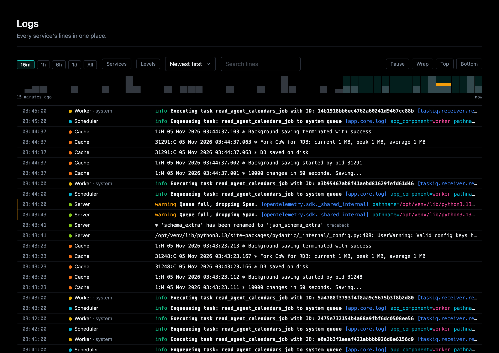
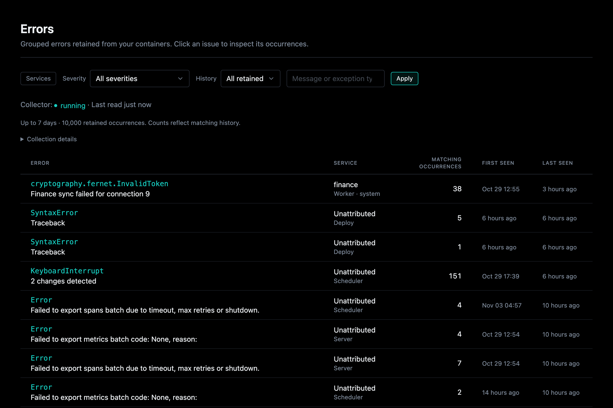

# Logs and Errors

Every part with a container behind it has a **Logs** section on its own page.
Overseer > Logs and Overseer > Errors gather them all in one place.

## Logs

Open **Logs** at `/overseer/logs`. The Services checklist includes installed
application services alongside runtime components and containers. Select AI,
Auth, or several services to see their attributed logs across containers;
combined selections include any matching service or container. The same filter
applies to history, live updates, and the volume chart. Rows show the application
service alongside its runtime, for example `AI · Worker`.



Components are in the checklist too, as their code (`Worker code`, `Cache
code`), apart from the runtimes above them: a line written or raised in a
component's own code names it.

Normal logs use the same automatic attribution as errors. Older lines without
attribution remain available under their runtime/container or with all filters
cleared. Logs come from Docker, and new lines are pushed while the page is
open; no additional Redis pipeline is used. A traceback names the first line of
the app's own code it passed through, linked to [Code](code.md).

## Errors

Open **Errors** beside Logs, or go directly to `/overseer/errors`. Collection runs
in the webserver background even when every browser is closed. It needs Redis
and the Docker runtime; minimal stacks still render the page with an explanation
when collection is unavailable.



The list groups explicit ERROR/CRITICAL messages and recognized exceptions by
service and cause. Click an issue to open the side drawer and inspect the selected occurrence, its
container, timestamp, level, safe structured fields, and stored stack trace.
Use the occurrence links to inspect older traces, or copy the selected trace.
An error without a stack trace cannot have one reconstructed from its message.
Detail URLs are bookmarkable; detail remains stable while the list updates.

The drawer opens with **In your code**: every frame of the stack trace in the
app's own code (`app/...`), where it broke first, each a link to its line in
[Code](code.md). In the trace itself those frames are links too, and a
library's frames are dimmed. An error logged during a request links to that
request's [replay](map.md#replay-a-request).

The Services checklist is the one Logs uses, so a filter carries between the two
pages. No selection means every source; an error from any selected runtime,
container or application service is shown, and an application service matches its
attributed errors across containers. The Service column shows the application
service above the runtime, named as Logs names it (`Worker · system`).
Logs without service evidence remain Unattributed.
Severity, history, and search filters apply to retained occurrences
before grouping and pagination. Counts and first/last times describe the matching
retained occurrences, not lifetime error totals. Detail history shows all retained
occurrences of the issue. Search covers exception type and the first 1,024 message
characters across the retained index (up to 10,000 occurrences), not only the
current page. The Logs link opens the service's last hour of logs; stored detail
survives Docker log rotation even when those source logs are no longer available.

Live updates use independent Redis notification readers for each viewer and
replace the grouped list. A reconnect rebuilds from retained state, including
after notification trimming. Server reconciliation every 15 seconds removes
quietly expired results. An open occurrence is preserved until navigation.

How errors are collected and credited to a service:
[How errors are collected](#how-errors-are-collected),
[How a line names its service](#how-a-line-names-its-service).

## How errors are collected

The backend's `startup/error_tracking.py` starts the collector through the shared
background task registry. The matching shutdown hook cancels and awaits pumps,
releases its lease when possible, and closes its Redis client. One 20-second
Redis lease per project fences writes from superseded collectors. Discovery and
lease renewal run every five seconds. Each running container on a known runtime
page has an independent stream; workers are supported without importing worker
modules. Sources reconnect with exponential backoff, capped at 30 seconds.

| Setting | Default | Meaning |
| --- | --- | --- |
| `ERROR_TRACKING_ENABLED` | `true` | Enable background collection |
| `ERROR_TRACKING_RETENTION_SECONDS` | `604800` | Maximum retained age: seven days |
| `ERROR_TRACKING_MAX_OCCURRENCES` | `10000` | Total retained occurrences per project; maximum 10,000 |
| `ERROR_TRACKING_MAX_BYTES` | `16777216` | Bytes the retained occurrences may take in Redis (16 MB); the oldest go first past it |
| `ERROR_TRACKING_MAX_SOURCES` | `64` | Concurrent container streams; maximum 256 |

Keys use `aegis:errors:<hash-of-PROJECT_NAME>:` and notifications use
`aegis:events:errors:<hash-of-PROJECT_NAME>`. Projects sharing Redis must use
distinct `PROJECT_NAME` values. Redis keyspace ownership is declared by the
repository and appears on Overseer's Redis page. History uses hashes and sorted
indexes; notifications are hints, capped at approximately 10,000 stream entries.

An occurrence is capped at 64 KiB including serialized JSON escaping. Each
source assembler holds at most 48 KiB per stdout/stderr record; the Docker stream
decoder bounds unfinished input to 1 MiB. Writes are awaited to apply backpressure.
Search metadata is bounded separately. Retention removes records, search metadata,
and indexes together in batches of at most 128 per atomic operation, yielding
between batches. Cleanup runs within one discovery tick plus batch processing
time; reading never writes. Empty issue indexes disappear. With no filter, the
list reads per-issue summaries each write keeps current; any filter reads the
search metadata once and groups it.
Active source cursors are removed when their containers leave discovery; lease
and shared health status expire automatically.

Replay identity retains Docker's original nanosecond timestamp and per-stream
ordinal, including non-error input. A source's position is saved at most once a
second, and reconnect re-reads the second before it; occurrence IDs absorb the
overlap. A fixed-size discarded-history watermark
prevents count-pruned records from returning on replay. Late inputs at or before
that boundary, including timestamp ties, are conservatively dropped and counted.

Recovery is **best effort within Docker log retention**, not a durable capture
or exactly-once promise. The restricted proxy does not expose exact restart
incarnations; container ID plus timestamp identify restart input. Rotation, missing
source timestamps, unfinished traces and oversized input can leave gaps. Bootstrap
looks back at most the retention window. Redis persistence/eviction configuration
determines whether history and cursors survive Redis restarts. Losing cursors may
trigger a broader retained-log replay; losing both source logs and Redis history
cannot be repaired.

Credential-shaped keys, authorization strings, URL credentials, and recognized
nested locals are redacted before retention. Redaction is best effort: secrets in
arbitrary exception prose may remain. Stored data is escaped when rendered; it is
never treated as HTML. Collector failures are reported through shared status,
rather than logging captured error diagnostics back into their own feed.

The page distinguishes disabled collection (configuration or missing Redis/Docker),
degraded collection (source/Redis failure, stale status, source cap), empty history,
and expired detail. For degraded collection, check Redis connectivity, the Docker
socket proxy, container logging drivers, and source limits. Sources retry without
blocking requests. A running state indicates current collection health; it does
not certify that Docker's historical logs are complete.

Run the isolated real Docker/Redis scenario from a generated project with Redis
and deploy installed:

```bash
AEGIS_ERROR_TRACKING_DOCKER_TEST=1 uv run pytest tests/components/test_error_tracking_integration.py -q
```

It uses unique Redis namespaces and disposable source containers, verifies
closed-browser collection, grouping, exact traces, replay, failover and container
replacement, and removes its containers and keys afterward. The Redis contract
and SSE tests run only against a Redis you name, never the development stack's,
each in its own namespace:

```bash
docker run --rm -d -p 6390:6379 --name error-test-redis redis
AEGIS_ERROR_TRACKING_REDIS_URL=redis://127.0.0.1:6390 uv run pytest tests/services/test_error_store.py -q
```

## How a line names its service

Keep using `from app.core.log import logger`. The shared logging processor derives
`app_service` from who owns the code (`app.core.ownership.owner`): a file under
`app/services/<name>/`, a route under `app/components/backend/api/<name>/` (by its
name, or the one service it imports), or a service's CLI, only when the name belongs
to the shared `ServiceName` registry, checked against the generator’s `ServiceSpec`
list; runtime-registered plugin services are also accepted. Shared folders such as
`system` and `change_queue` are not application services. A line or exception from
a component's own code also names it as `app_component` (`app/components/<name>/`,
or a core client such as `app/core/cache.py` by the component it fronts).
Existing logger calls need no per-function context manager. `emitting_service`
records the service that wrote the log. For exceptions, the processor inspects
traceback frames and chained causes before formatting, allowing an AI failure
logged by an HTTP handler to retain its AI origin. Suppressed exception contexts
are not used. This is code-location attribution, not proof of the underlying
system responsible for a failure.

Scheduled job discovery retains the declaring service. The existing execution
wrappers establish scoped ownership automatically on scheduler and worker runs,
restore it after completion/failure, and preserve exception ownership for outer
handlers. Every process sets the same logging pipeline up as it boots
(``apply_saved_overrides``), workers started by their own CLI included. Arbitrary
process/thread handoffs outside those wrappers do not automatically inherit it.

Both development console logs and production JSON logs carry attribution into
retained errors. The runtime `service` and container identity remain separate
from `app_service`. The Errors checklist is the Logs one, with the same query
parameters (`service`, `container`, `app_service`, `app_component`), so a filter
carries between the two pages. Grouping includes the application service, never
the component, so naming components regrouped no existing issue.
