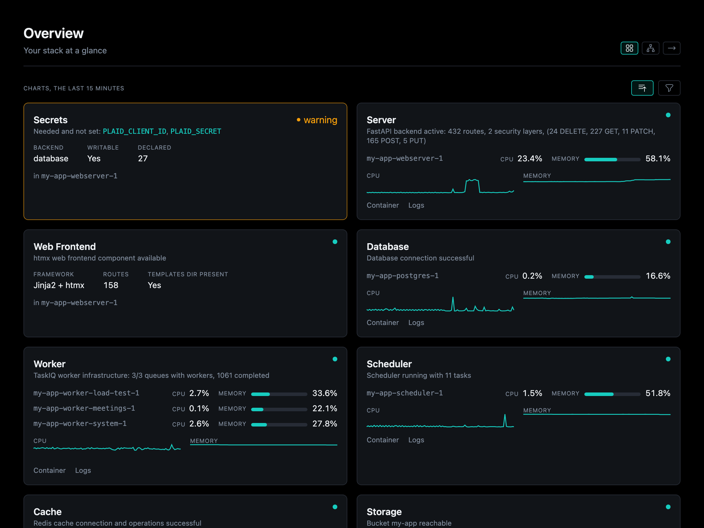
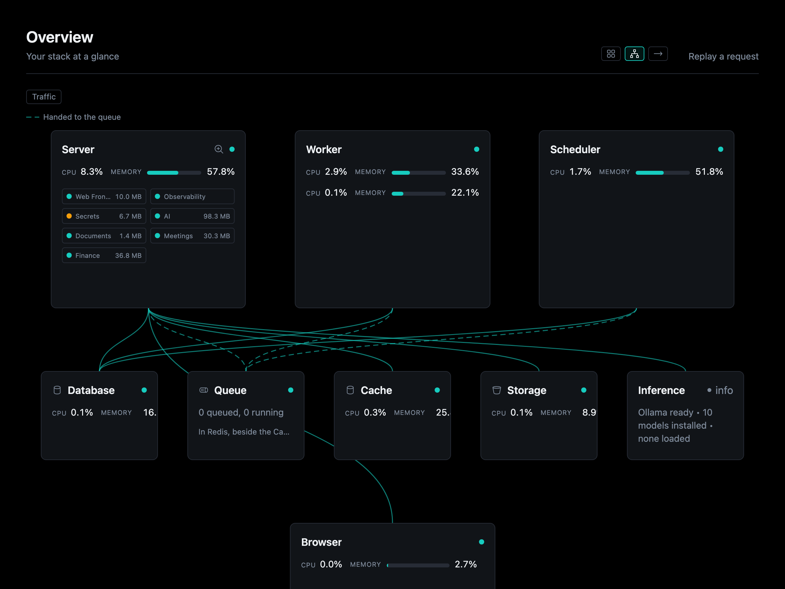
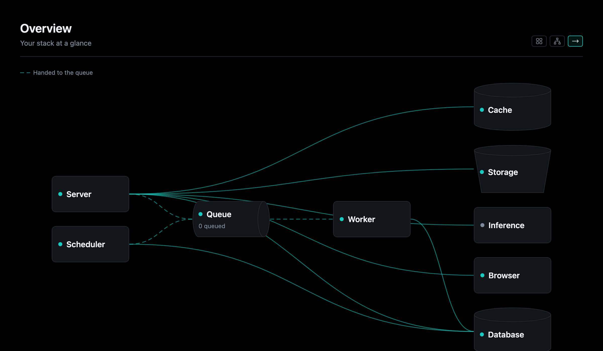
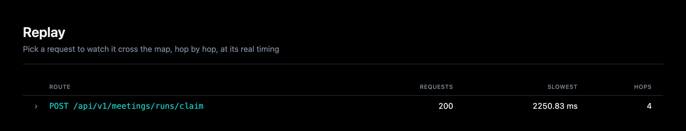

# Overview and the Map

Overseer opens on the whole stack, kept live, in one of three views (the
toggle at the top, kept in the address as `?view=`):

| View | Shows |
|------|-------|
| **Cards** | A card for each part, in the sidebar's order: its status and health line, and with containers each one's CPU and memory over the last 15 minutes and the way to its Container and Logs. **Trouble first** (the default) puts the parts not well at the top; **Only trouble** hides the rest |
| **Map** | The [Twin](twin.md) drawn: each process a node in its tier, the connections between them as lines, and what runs in the webserver as chips in the Server's node |
| **Flow** | The stack's processes and stores left to right, the way work moves (through the queue to the worker), each in its shape |

## The Map

Each process is a node at a fixed place, so the map draws the same every time
and nothing overlaps. A node links to its page, with its state and its
containers' CPU and memory. Lines take the tone of what they lead to: dashed
for queued work, dotted for a key Secrets holds. Data is drawn in its shape (a
store, the queue, object storage).

**Zoom.** Open the Server to see what runs inside it, what each part reaches,
and the outside providers whose key is not set (each with its key's dialog one
click away). Open a service to see its pieces (router, facade, domains) and
what each reaches. Every level reads the same way, the way a C4 diagram does.

**Traffic.** The Traffic chip tones each node by how much ran through it
instead of its health: every call along the lines touching it, Overseer's own
reads included, counted as it happens with no tracer.

**What the code should fix.** Opened up, a part or a piece that breaks the
[service standard](../services/index.md) is marked with how many places it
should fix. Hover for what to do and each place, linked to its line in
[Code](code.md). The mark is about the code; the node's tone stays its health.

## Replay a request

**Replay a request** (`/overseer/replay`) picks one of the last 200 requests
the server answered and plays it on the map, a level at a time: the Server
opened up where the request went past one service, then each service it ran
in, each drawing only what the request went through.

Each hop it made (a service calling another, a query and its tables, a
provider called, work queued) lights as it ran, at its real timing slowed down
to watch, the slowest held and a failure flashed, and is said in words under
the controls. The **Hops** view lists them in the order they ran, each at its
line in [Code](code.md).

A request's id rides every answer as `X-Request-Id` and every line it logs as
`request_id`, so Routes' **Execute** answer and an error logged during a
request link straight to its replay. The same requests are
`GET /api/v1/requests` and Illiana's `requests` tool. Overseer's own pages are
not kept.
