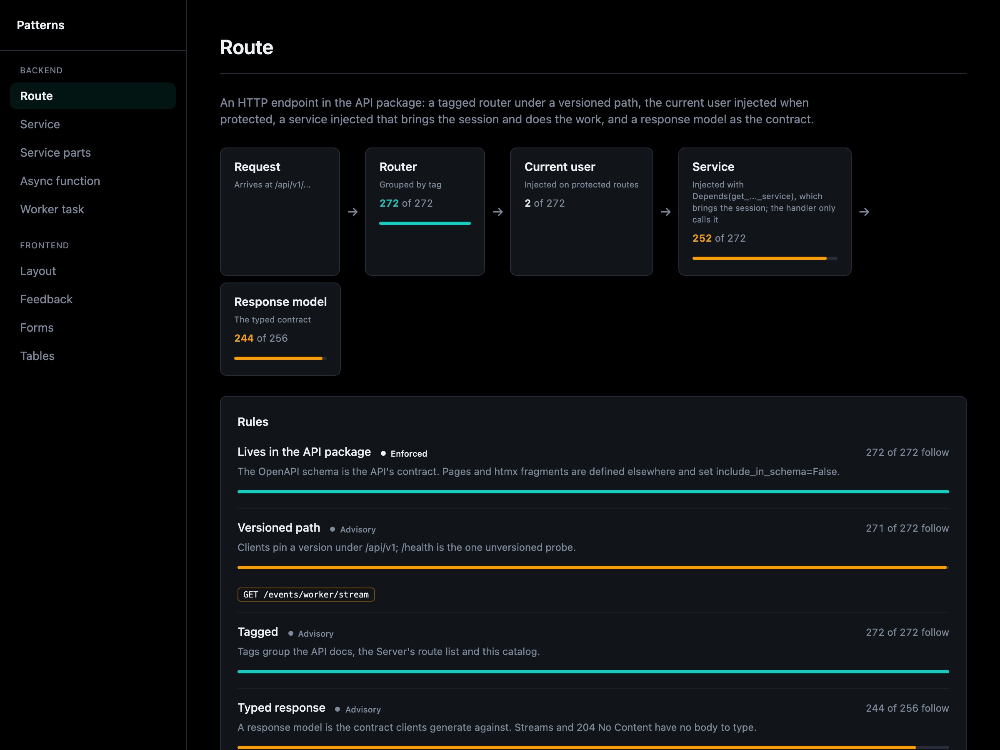

# Patterns

Overseer > Patterns is how this app is built, for a person or an agent to read
before building something new.

**Backend.** Each pattern (a route; a worker task, with the worker) is one
definition: the steps of its diagram, how to find its instances, and its rules,
each with the reason behind it and what is exempt. The page lists every
instance found in the running app and where one breaks a rule. Instances are
found, never listed by hand, so the page cannot drift from the code. A test
holds the enforced rules at zero violations, and the same report is what an
agent reads.

**Frontend.** The shared macros every page is built from (layout, feedback,
forms, tables), each rendered live with how to call it. A new page reuses
these rather than drawing its own.

The service standard itself (a facade, reads in `queries.py`, a health check)
is checked from the shell and in CI with `patterns check`, and its findings
are marked on the [map](map.md#the-map).
