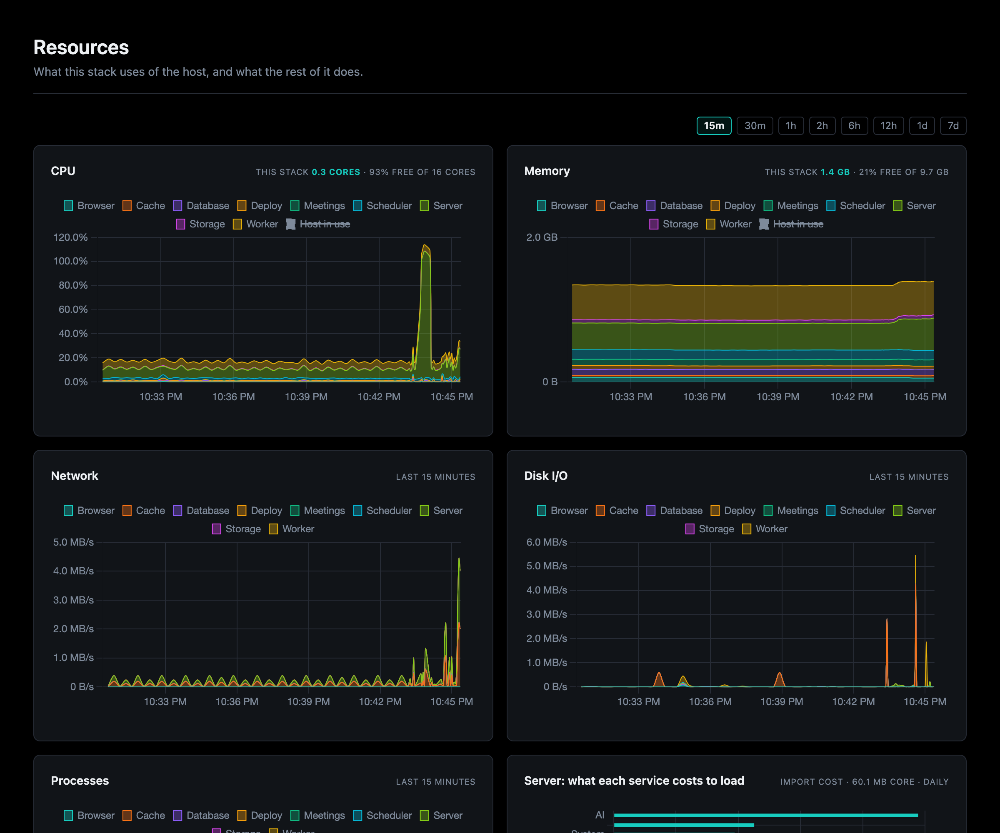

# Resources

Overseer > Resources is everything the stack uses at once, charted over the
window you pick, and kept live while the page is open.

- **CPU and memory**, each split three ways in its header: this stack (its
  containers, added up), the rest of the host, and what is free. The chart
  stacks a line per part, so its top edge is this stack, with the host's in
  use dashed across it.
- **Network, disk I/O and processes**, a line per part.
- **What each service costs to load**: inside the webserver, which Docker sees
  as one container, what each part adds on top of Python and the app's core.
  Measured once a day, one part at a time.
- **Needs attention**: a container that is stopped or failing, with what is
  wrong and the way to its part's page. Nothing shows while every one is well.
- **Outside Docker**: a server that runs on the host rather than in a
  container, named, as it has no container to read.

It reads what is already sampled (the containers sampler, the host checks, the
host's size), so the page adds no load of its own. On Docker Desktop the host
Docker reports is its VM, so "the host" is the VM's CPU and memory.

Each part's own page charts the same figures for its containers, and the
Overview's cards show the last 15 minutes of each.
