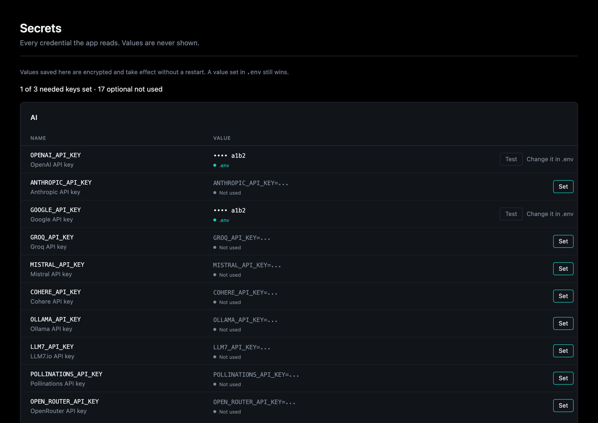
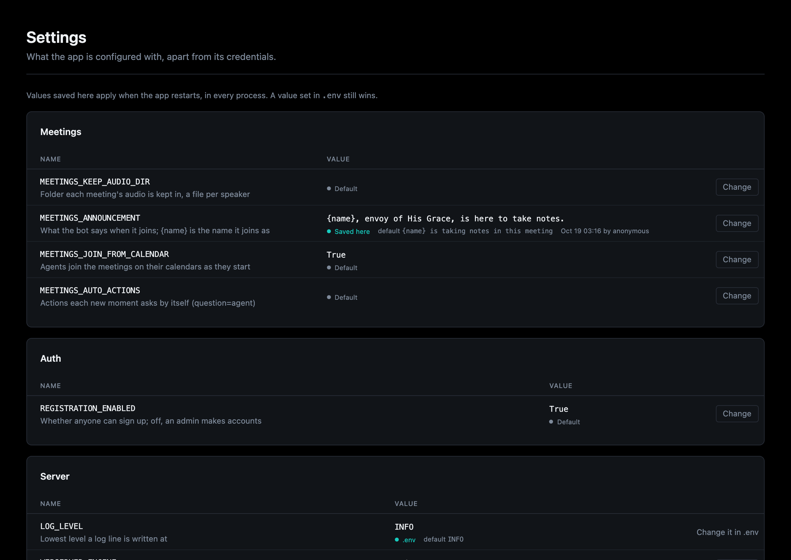

# Secrets and Settings

Two pages for what the app is configured with. Neither ever shows a secret's
value.

## Secrets

Overseer > Secrets lists every credential the app declares, grouped by the code
that reads it: where it is set, its last four characters, whether it is
needed, and for one that is missing, the `.env` line to add. A key with a check
has a **Test** button.

Without the [secrets component](../components/secrets/index.md) it is
read-only: values live in `.env` and change on restart. With it, the page moves
to the component's own and sets, replaces and removes keys while the app runs,
each checked against its provider when pasted, stored encrypted, and audited
(who and when, never the value). A key set in `.env` still wins and shows as
read-only.

Details: [Secrets](../components/backend/secrets.md).

## Settings

Overseer > Settings lists every setting marked configurable (a health
threshold, how long an account stays locked, the scheduler's timezone), grouped
by the code that reads it, with its value, where it comes from and its default.
Each component's or service's own page has a **Settings** section with its
group alone. With the secrets component, one `.env` does not set can be saved
from the page, and applies when the app restarts; without it, values change in
`.env`.

Details: [Settings](../components/secrets/settings.md).

Both pages make changes only where Overseer allows them: on the local dev build
without auth, or for admins with it
([Who can open the Overseer](../components/web-frontend/index.md#who-can-open-the-overseer)).
