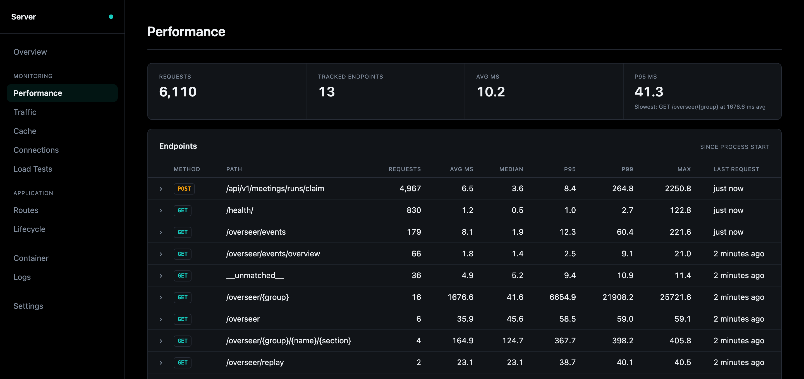
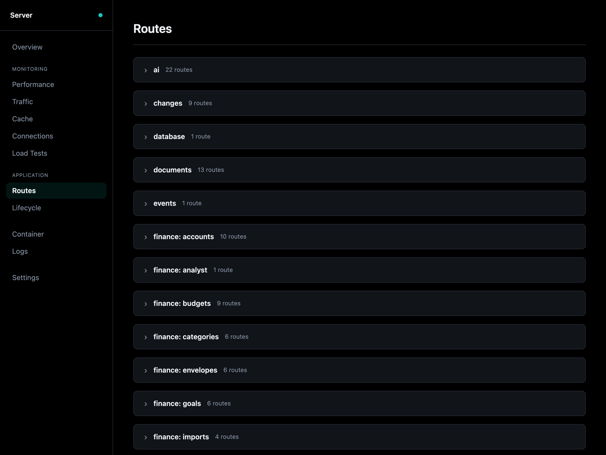

# Server

The Server page is the webserver, the one part every stack has: how it is
doing, what reaches it, and what it serves.

| Section | Shows |
|---------|-------|
| **Overview** | Its status, its containers' CPU and memory over time, and endpoints that are not routes |
| **Performance** | Each endpoint's requests and latency (min, average, median, p95, p99, max) since the process started |
| **Traffic** | Where requests come from: the top source IPs and each one's share, with a warning when one dominates |
| **Cache** | What is in the cache, grouped by what it is for, how much room each group takes, and whether it earns that room (hit rate) |
| **Connections** | Every WebSocket and event stream, open and recently closed; a row opens its timeline |
| **Load Tests** | Start a load test on a route, and every run with its throughput, latency and errors, the CLI's included |
| **Routes** | Every route by tag: send a request from the page, load test it, walk its dry path, see it on the map |
| **Lifecycle** | What runs when the app starts, wraps every request, and runs when it stops: startup hooks, the middleware stack, shutdown hooks |

## Routes

Each route shows its method, path, response model, the dependencies that
resolve before it runs, and whether it needs sign-in. Expanded, it has:

- **A request form** built from its OpenAPI operation, as `/docs` has. **Execute**
  sends it once, in the server, as admin, a user or anonymous, and shows the
  curl command, status, time, body and headers. A route that writes is sent
  only once you tick the box under it.
- **Dry path**: every hop the route can take, read from the code without
  sending anything (the handler, the services it calls, the tables a query
  names, work handed to the queue, the providers it calls), each at its line
  in [Code](code.md). **Show on the map** lights the parts it crosses.
- **Load test this**: Load Tests, with the route and your values filled in.

Details: [Routes](../components/backend/routes.md#inspecting-routes-in-overseer),
[Load testing](../components/backend/load-testing.md#overseer),
[Lifecycle](../components/backend/lifecycle.md),
[Cache](../components/backend/cache.md).
