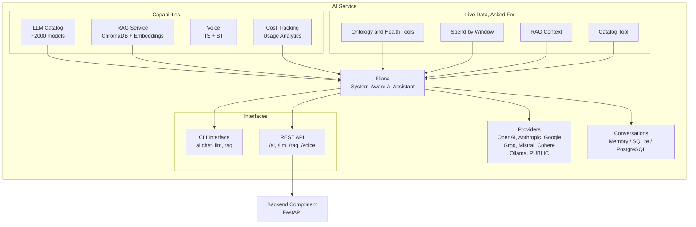

# Illiana


**Illiana** is the conversational AI interface that ships with every AI-enabled Aegis Stack project. She is not a generic chatbot. She has live awareness of your running system through context injection, and she can search your codebase when RAG is enabled.

She is not required to use Aegis Stack, and nothing in the system depends on her being present. When enabled, she becomes another way to understand what your application is doing and why, alongside the CLI and Overseer.

## What Makes Her Different

Illiana answers from what your system is actually doing right now, not what it could theoretically do. She works in code mode (with PydanticAI): her reads run inside one short script that fetches, counts and joins them, and only the answer comes back to her. She reads it when asked, through her tools, rather than carrying it in every prompt: her system prompt holds nothing live, so a provider's prompt cache serves it turn to turn.

| Where | What She Knows | Example Questions |
|---------|---------------|-------------------|
| **Ontology tool** | The [Twin](../../overseer/twin.md), the app's model of itself (its ontology layer and, on each part, its live state): a part's health check, the errors it owns, the AI service's spend by window (today, 7 days, all time) | "Is my database healthy?" "How much have I spent today?" |
| **Health tool** | Every component's status (admins) | "How is the system doing?" |
| **Catalog tool** | Available models, prices, context windows | "What's the cheapest model with vision?" |
| **Errors tool** | What broke: errors grouped into issues by where they come from, each with its traceback (admins) | "Which service has the most open errors?" |
| **Requests tool** | The requests the server answered, each hop by hop at its real timing, named as the dry path names it (admins) | "Why was that request slow?" "What did the 401 do?" |
| **Storage tool** | What the buckets hold: the buckets, or one level of one (admins) | "What's in the my-app bucket?" |
| **Cards** | A table, bar, pie, before-and-after or trend drawn under her answer, from figures she just read (`draw_card`; with a database) | "Chart my spend by vendor this week." |
| **Flows** | A flow on the map, played under her answer by the Replay page's own player: a request's replay at its real timing, a route's code path (what its code can do, read without running it), a flow's stops joined along the map's own lines (a stop nothing reaches is refused), staged a beat a hop, or how one part is wired: the edges the ontology answers for it, on the map, still (`draw_card("path", ...)`; admins). Every hop is the app's own, run, read or declared, never guessed. A still thumbnail in the thread; a flow plays opened larger. Each part she names in her answer lights on the card when you hover or tap it, and on a call as she says it | "Show me the replay of that 401." "Show me the code path for GET /me." "How does sign-in flow?" "How is the AI service wired up?" |
| **Plugins tool** | The plugins this app has, and those it could add from the directory at aegis-stack.io, with what each is, its downloads, stars and the commands that add it (admins) | "What plugins could I add for scraping?" |
| **RAG** | Your codebase (when indexed) | "How does auth work in this project?" |

While something is wrong, one line on her current message says what ("comms partly set up, ollama cold"), so "is anything wrong?" needs no tool call and the line never sits in her history.



## Getting Started

```bash
# Generate a project with AI
aegis init my-app --services "ai[sqlite,rag]"
cd my-app && uv sync && source .venv/bin/activate

# Start chatting
my-app ai chat
```

```
Illiana v0.6.4
Provider: public | Model: auto

You: What can you tell me about my system?
Illiana: I can see your system is running with...
```

### With Codebase Context

Index your code so Illiana can reference specific files and line numbers:

```bash
# Index your codebase
my-app rag index ./app --collection code --extensions .py

# Chat with RAG enabled
my-app ai chat --rag --collection code --top-k 20 --sources
```

Now she answers from your actual code instead of generic knowledge:

```
You: How does the auth service validate tokens?
Illiana: Based on your codebase, token validation happens in
app/services/auth/service.py [1]. The validate_token() method...

Sources:
[1] app/services/auth/service.py:42
[2] app/components/backend/api/auth/router.py:15
```

## Slash Commands

During interactive chat, use slash commands for quick actions:

| Command | Description |
|---------|-------------|
| `/help` | Show available commands |
| `/model [name]` | Show current model or switch to a new one |
| `/status` | Show current configuration |
| `/new` | Start a new conversation |
| `/rag [off\|collection]` | Toggle RAG mode or select collection |
| `/sources [enable\|disable]` | Toggle source references in output |
| `/clear` | Clear the screen |
| `/exit` | Exit the chat session |

### Switching Models Mid-Conversation

```
You: /model gpt-4o
✓ Switched to OpenAI/gpt-4o

You: /model claude-sonnet-4-20250514
✓ Switched to Anthropic/claude-sonnet-4-20250514
```

Tab completion is available for model names (populated from Ollama and configured cloud providers).

### RAG Controls

```
You: /rag code
✓ RAG enabled with collection: code

You: /sources enable
✓ Source references enabled

You: /rag off
RAG disabled
```

## Context and Live Data

Illiana's system prompt is her persona, the model in force, her saved memory and her memory modules (the app map), plus retrieved code when RAG is on. Nothing in it changes turn to turn. The app map names each part with what it is for and how it is built (each option as chosen, and what else it could be: `backend taskiq (of arq, taskiq, dramatiq)`), the scheduled jobs with whose they are and when they run, the tables and the changes that can be proposed. A job reaches the parts its code imports, so asking about the database finds the job that backs it up.

### Live data, asked for

**Sources:** `app/services/system/node_now.py`, `app/services/ai/domains/llm/catalog.py`

Asking the `ontology` tool about a part returns its `now` beside its structure: its health check (trimmed to what fits a prompt; `omitted` names the rest), the error issues it owns (latest first, with a total) and, for the AI service, what it spent today, over the last 7 days and in all, each split by vendor (who served the model), by what it was for (chat, live calls, transcription) and by voice or text, with when each was read. Beside it, `findings`: what the part's code breaks of the service standard, the same findings Overseer's map shows (each rule, how bad, why, the file and line, what to do), so she can say how a part is built, not only how it is doing. The part itself carries `options`: what else it could be, generated from the aegis CLI's own declarations (the AI backend's `memory`, `sqlite` and `postgres`, auth's levels, the worker's backends), each with its default, the choice this stack was generated with and what each choice means. Asked whether the AI service needs a database, she can say it does not: memory is the default, and this stack chose sqlite. The `health` tool gives every component at once, the `catalog` tool the models on offer with their prices, and the `plugins` tool what this app has installed and what the public directory lists (the first hundred, with how many match; its search text narrows them). Each answer is a frozen Pydantic model (`NodeNow`, `CatalogAnswer`) that rejects fields it does not declare.

### What is wrong right now

`node_now.right_now()` reads every check that is not healthy; while there is one, a single line rides her current message, never her system prompt or her history.

### RAG Context

**Source:** `app/services/ai/rag_context.py`

When RAG is enabled, search results are formatted as markdown with file names, line numbers, and syntax highlighting. Illiana is instructed to answer from this code, not generic knowledge.

### Prompt Assembly

**Source:** `app/services/ai/domains/chat/prompts.py`

Her persona is the `assistant` agent's `system_prompt`, seeded with the whole text and edited like any agent's (see [Agents](agents.md)). `build_system_prompt()` appends the model in force, retrieved code and saved memory after it.

## Chat Modes

### Single Message

```bash
my-app ai chat "Explain the architecture of this project"
```

### Interactive Session

```bash
my-app ai chat
```

Features:

- Conversation memory (context maintained during session)
- Markdown rendering in terminal
- Streaming responses
- Slash commands
- Tab completion for models and collections

### With RAG

```bash
my-app ai chat --rag --collection code --top-k 20 --sources \
  "How does the scheduler component work?"
```

| Flag | Description |
|------|-------------|
| `--rag` | Enable RAG context |
| `--collection` | Collection to search |
| `--top-k` | Number of search results to include |
| `--sources` | Show source file references after response |

## API Access

Illiana is also accessible via the REST API:

```bash
# Chat
curl -X POST http://localhost:8000/api/v1/ai/chat \
  -H "Content-Type: application/json" \
  -d '{"message": "What is the health of my system?"}'

# Stream
curl -X POST http://localhost:8000/api/v1/ai/chat/stream \
  -H "Content-Type: application/json" \
  -d '{"message": "Explain the auth service"}' \
  --no-buffer
```

See [API Reference](api.md) for full endpoint documentation.

## Configuration

Illiana uses the same configuration as the AI service:

```bash
# .env
AI_ENABLED=true
AI_PROVIDER=public      # or openai, anthropic, groq, ollama, etc.
AI_MODEL=auto
AI_TEMPERATURE=0.7
AI_MAX_TOKENS=1000
```

Switch models at any time:

```bash
my-app llm use gpt-4o
my-app llm use claude-sonnet-4-20250514
```

---

**Next Steps:**

- **[RAG](rag.md)** - Index your codebase for Illiana to search
- **[LLM Catalog](llm-catalog.md)** - Browse and switch models
- **[Provider Setup](providers.md)** - Configure AI providers
- **[CLI Commands](cli.md)** - Complete CLI reference
