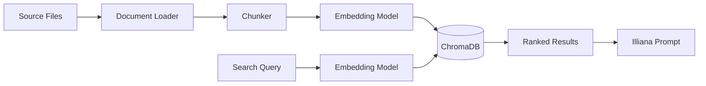

# RAG (Retrieval-Augmented Generation)


RAG enables semantic search over your codebase or documents. Index files into ChromaDB collections, then search them directly or let Illiana use them as context during conversations.

## What You Get

- **Codebase-aware AI** - Illiana answers questions using your actual code, not generic knowledge
- **Semantic search** - Find relevant code by meaning, not just keyword matching
- **ChromaDB backend** - Persistent vector store with efficient similarity search
- **Dual embedding providers** - Local sentence-transformers (~400MB, free) or OpenAI API
- **File-level management** - Add, update, or remove individual files from collections
- **CLI and API** - Full access via command line and REST endpoints

## Quick Start

```bash
# 1. Generate project with RAG enabled
aegis init my-app --services "ai[sqlite,rag]"
cd my-app && uv sync && source .venv/bin/activate

# 2. Index your documents and code (into "default", what Illiana knows)
my-app rag index ./docs
my-app rag index ./app --extensions .py

# 3. Search them
my-app rag search "how does authentication work"

# 4. Ask Illiana: she searches it with her knowledge tool, citing sources
my-app ai chat "Explain how the auth service validates tokens"
```

---

## Architecture



### Pipeline

1. **Loading** - `CodebaseLoader` reads files, applies default and configured exclude patterns, and extracts metadata (path, name, extension)
2. **Chunking** - `DocumentChunker` splits documents into configurable-size chunks with overlap, preserving line numbers
3. **Embedding** - Text chunks are converted to vectors using sentence-transformers (local) or OpenAI API
4. **Indexing** - Vectors are stored in ChromaDB with metadata for retrieval
5. **Search** - Query text is embedded and compared against stored vectors using cosine similarity

---

## CLI Commands

### rag index

Index documents from a path into a collection:

```bash
# Index a directory
my-app rag index ./app --collection code

# Filter by extension
my-app rag index ./app --collection code --extensions .py,.ts
```

```
╭──────── Collection: code ─────────╮
│ Successfully indexed 1,523 chunks │
│ from 87 files                     │
│                                    │
│ Extensions: .py                   │
│ Duration: 8.3s                    │
│   Loading:  1.2s (14%)            │
│   Chunking: 0.8s (10%)           │
│   Indexing: 6.3s (76%)           │
│ Throughput: 183.5 chunks/sec     │
│ Collection size: 1,523 chunks    │
╰────────────────────────────────────╯
```

### rag add

Add or update a single file (upsert semantics):

```bash
my-app rag add app/services/auth.py --collection code
my-app rag add app/services/auth.py -c code --show-ids
```

### rag remove

Remove a file's chunks from the collection:

```bash
my-app rag remove /path/to/file.py --collection code
my-app rag remove /path/to/file.py -c code --force
```

### rag files

List indexed files with chunk counts:

```bash
my-app rag files --collection code
```

### rag search


Semantic search across indexed documents:

```bash
# Basic search
my-app rag search "how does authentication work" --collection code

# Show full content of results
my-app rag search "database connection" -c code --content

# More results
my-app rag search "error handling" -c code --top-k 10
```

Results show relevance scores and file references:

```
Found 5 results:

╭── #1 service.py ──────────────────╮
│ Score: 0.8932                     │
│                                    │
│ class AuthService:                │
│     async def validate_token(...  │
╰── app/services/auth/service.py ───╯
```

### rag list

List all collections with document counts:

```bash
my-app rag list
```

### rag delete

Delete a collection and all its documents:

```bash
my-app rag delete code
my-app rag delete code --force
```

### rag status

Show RAG service configuration:

```bash
my-app rag status
```

```
╭──────── RAG Service Status ────────╮
│ Enabled: Yes                       │
│ Persist Directory: .chromadb       │
│ Embedding Model: all-MiniLM-L6-v2 │
│ Model Status: Installed            │
│ Chunk Size: 1000                   │
│ Chunk Overlap: 200                 │
│ Default Top K: 5                   │
│ Collections: 2                     │
╰────────────────────────────────────╯
```

### rag install-model

Pre-download the embedding model for offline/air-gapped use:

```bash
# Download to default location (~400MB)
my-app rag install-model

# Custom cache directory
my-app rag install-model --cache-dir /path/to/models

# Specific model
my-app rag install-model --model sentence-transformers/all-MiniLM-L6-v2
```

!!! note
    Only needed for local sentence-transformers. OpenAI embeddings don't require a local download.

---

## Illiana's Knowledge

The `default` collection is what Illiana knows: `rag index <path>` fills it, and her `knowledge` tool searches it when a question is about the app, its business or its documents, citing each passage's source. The tool searches whatever knowledge bases (collections) the asking agent is granted, its `knowledge_base_ids`; an agent granted none searches nothing. Illiana is granted `default` on a fresh seed and on a re-seed of an older database, additively, so a knowledge base granted by hand stays. The tool is a read, so an MCP client may be served it.

Overseer fills it too, and nobody types a path: on the AI page's Knowledge section, **New knowledge base** makes a collection from parts of the app ticked (a service, a component, the shared code, the docs) and the file types to read of them, and files uploaded for what is not this app. The twin knows which files each part owns, templates and stylesheets as much as code, so ticking `ai` reads the AI service's files and nothing else. The file types offered are the ones those parts hold that the loader reads (`LOADER_MAP` in `loaders.py`, grouped as code, web, config, data, docs and scripts), the loader's defaults ticked; the form totals files, size and about how many chunks as things are ticked. A collection's drawer lists each file with its type, chunks and when it was indexed, linked to it in Overseer > Code when it is the app's own; a file's menu opens it there, re-indexes it or removes it. The drawer adds more the same way, and behind its "..." menu re-indexes every source (after a change of embedding model or chunking) or deletes the collection.

Adding from Overseer runs as a background job in the webserver (the one process that writes the index), a batch of 50 files at a time: each batch is read, chunked, embedded and stored, then dropped, so memory holds a few batches however much is picked.

Embedding is the slow part, so with a worker it happens there: each batch is a task on the system queue (four out at a time), and its vectors come back through Redis (`rag:embedded:<run>`) to the webserver, which stores them. Embedded Chroma is safe in one process only, so no other process ever writes it, and no Chroma server is needed. The webserver loads the model only to search (and once when a collection is made, to record which model it uses): counts, file lists, removals and stores of vectors embedded already never load it, and the load runs in a thread, so the server keeps answering meanwhile. A worker process loads the model once and embeds one batch at a time, with every CPU it has (the webserver leaves one spare for its own work); more worker processes (`SYSTEM_WORKER_PROCESSES`, or replicas) embed more batches at once. With RAG in the stack the system worker gets 2G and 2 CPUs and the webserver 1.5G (`SYSTEM_WORKER_MEMORY`, `SYSTEM_WORKER_CPUS`, `WEBSERVER_MEMORY` override them). Uploaded files are embedded in the webserver, since only it is sure to see them (reading a collection again too), once the workers have their batches. An empty file (an `__init__.py`) holds nothing to know and is passed over, not called unreadable. Each batch is numbered: one handed back twice (a task retried after it answered) is stored once, and the job ends only when every batch is in. A batch that does not come back within ten minutes, or that a worker could not embed, fails the job, saying how many are missing; what was stored stays, and running it again is safe: a file's new chunks are stored over its old ones (the same ids), then only those past its new end go.

Without a worker, every batch is embedded in the webserver, one at a time: slow on CPU for a large pick, and the dialog says so. Add a worker (`aegis add worker`), or embed with a hosted model (`RAG_EMBEDDING_PROVIDER=openai`).

The dialog closes at once and the collection's drawer follows the job, its progress pushed over SSE as it changes, and loads the new files when it ends; one job runs per collection at a time, and a collection being indexed cannot be deleted (409) until it finishes. A name the index cannot take (3 or more letters, digits, dots, dashes or underscores, no spaces) is refused before anything is read (by the dialog as it is typed, and the API with a 400, `POST /rag/index` too), and by the CLI before anything is embedded. The API's `POST /rag/collections/{name}/sources` reads the same way and answers when done.

An uploaded source is kept beside the index (`sources/<collection>/`) so it can be read again. However it leaves, it goes from there too: removed (`rag remove`, the API, Overseer), its collection deleted, or its collection rebuilt by `rag index`. A file the server held is never touched.

With a database, each collection is also a `knowledge_base` record and each file indexed into it a `knowledge_base_source`, kept to the index whenever they are read (`GET /rag/knowledge`). The index is the truth; the records add what it cannot hold, such as what a knowledge base is for.

---

## API Endpoints

All endpoints are prefixed with `/rag`. A read needs a signed-in user; a change (indexing, adding or removing a source, deleting a collection) needs an admin, since an index call names a path on the server.

### POST `/rag/index`

Index documents from a path.

```json
// Request
{
  "path": "./app",
  "collection_name": "code",
  "extensions": [".py", ".ts"],
  "exclude_patterns": ["**/test_*"]
}

// Response
{
  "collection_name": "code",
  "documents_added": 1523,
  "total_documents": 1523,
  "duration_ms": 8300.5
}
```

### POST `/rag/search`

Semantic search across a collection.

```json
// Request
{
  "query": "how does authentication work",
  "collection_name": "code",
  "top_k": 5,
  "filter_metadata": null
}

// Response
{
  "query": "how does authentication work",
  "collection_name": "code",
  "results": [
    {
      "content": "class AuthService:\n    ...",
      "metadata": {"source": "app/services/auth/service.py"},
      "score": 0.8932,
      "rank": 1
    }
  ],
  "result_count": 5
}
```

### GET `/rag/collections`

List all collection names.

### GET `/rag/collections/{name}`

Get collection info (name, document count, metadata).

### GET `/rag/collections/{name}/files`

List indexed files with chunk counts.

### POST `/rag/collections/{name}/sources`

Add sources, multipart: any number of `file` uploads (each kept beside the index, in `sources/<name>/`), a `path` the server holds (a file or a folder), and parts of this app as `part`, repeated (the ids `GET /rag/knowable` lists: the twin reads each part's own files). `extensions` (`.py, .md`, as `rag index --extensions` takes them; the loader's defaults when empty) and `exclude` (globs, in place of the loader's own), comma-separated, apply to the folder and the parts. Each file's chunks are replaced, so the collection's other sources stay; with `replace=true` they go too, once the new ones are in (the end `rag index` reaches). Nothing changes when nothing can be read. Answers the files read, their chunks and any upload that could not be read; 400 when nothing could be. An admin's.

### GET `/rag/knowable`

What of this app a knowledge base can know: its parts by kind (the ids `part` takes), the file types they hold (grouped as code, web, config, data, docs and scripts), each part's files and bytes by type, the types ticked by default, every type an upload may be, and the app's name and the folder it is read from. An admin's: it names the server's folder and what is in it.

### POST `/rag/collections/{name}/reindex?source=<path>`

Read every source of the collection again (after a change of embedding model or chunking), or `source` alone, by its path as the collection's files list it. Answers as adding does; 400 for a `source` the collection does not hold, which is never read in. An admin's.

### DELETE `/rag/collections/{name}/sources?source=<path>`

Remove one source, by its path as the collection's files list it. 404 when the collection holds none.

### DELETE `/rag/collections/{name}`

Delete a collection.

### GET `/rag/knowledge`

With a database: every knowledge base and its sources (name, path, type, chunks, when indexed), brought up to the index first.

### GET `/rag/health`

RAG service health status and configuration.

---

## Embedding Providers

| Provider | Type | Cost | Speed | Setup |
|----------|------|------|-------|-------|
| **sentence-transformers** | Local | Free | Moderate | ~400MB download, auto on first use |
| **OpenAI** | Cloud API | Per-token | Fast | Requires `OPENAI_API_KEY` |

### sentence-transformers (Default)

Runs entirely locally. The model downloads automatically on first use (~400MB). No API key needed.

```bash
# Pre-download for offline use
my-app rag install-model
```

### OpenAI Embeddings

Cloud-based, faster for large datasets. Requires an API key.

```bash
# .env
RAG_EMBEDDING_PROVIDER=openai
OPENAI_API_KEY=sk-...
```

---

## Configuration

Environment variables for RAG:

| Variable | Default | Description |
|----------|---------|-------------|
| `RAG_EMBEDDING_PROVIDER` | `sentence-transformers` | `sentence-transformers` or `openai` |
| `RAG_EMBEDDING_MODEL` | `BAAI/bge-small-en-v1.5` | Embedding model name |
| `RAG_MODEL_CACHE_DIR` | system default | Local model cache path |
| `RAG_CHUNK_SIZE` | `2000` | Characters per chunk |
| `RAG_CHUNK_OVERLAP` | `400` | Overlap between chunks |
| `RAG_DEFAULT_TOP_K` | `15` | Default search results count |

---

## Chat Integration

In a chat or a call, Illiana reaches the index through her `knowledge` tool (see [Illiana's Knowledge](#illianas-knowledge)): she searches when a question is about the app, its business or its documents, and cites each passage's source. An agent searches only the knowledge bases granted to it.

### Context Injection

When RAG is enabled, search results are injected into Illiana's system prompt:

**RAGContext** (`app/services/ai/rag_context.py`):
- `format_for_prompt()` - Markdown with file names, line numbers, syntax highlighting
- `format_sources_footer()` - Citation-style source references (`[1] app/services/auth.py:42`)
- `to_metadata()` - Storage-friendly format for conversation metadata

---

## Source Files

| File | Purpose |
|------|---------|
| `app/services/rag/service.py` | Core RAG service |
| `app/services/rag/config.py` | Configuration |
| `app/services/rag/loaders.py` | Document loading |
| `app/services/rag/chunking.py` | Text chunking |
| `app/services/rag/embedding.py` | Files read, chunked and embedded a batch at a time, on the workers when there are any, handed back through Redis |
| `app/services/rag/separators.py` | Where the chunker cuts, by language |
| `app/services/rag/vectorstore.py` | ChromaDB wrapper |
| `app/services/rag/shaping.py` | Metadata, filters, dedup |
| `app/services/rag/sources.py` | Sources added (uploads kept beside the index, server files or folders) or replacing a collection, every source read again |
| `app/services/rag/uploads.py` | Where an uploaded source is kept (never anywhere else), and letting kept ones go with their source or collection |
| `app/services/rag/knowable.py` | What of the app can be known: each part (the twin's map) and the docs, with their readable files by type and size |
| `app/services/rag/knowledge.py` | The knowledge base's records, kept to the index (with a database) |
| `app/services/ai/domains/chat/knowledge.py` | The `knowledge` tool |
| `app/services/ai/domains/chat/rag_context.py` | Prompt context formatting |
| `app/cli/rag/` | CLI commands |
| `app/components/backend/api/rag/routes.py` | API endpoints (`sources.py`: one source; `knowledge.py`: the records) |

---

**Next Steps:**

- **[Cost Tracking](cost-tracking.md)** - Usage analytics
- **[LLM Catalog](llm-catalog.md)** - Model registry
- **[CLI Commands](cli.md)** - Complete CLI reference
- **[API Reference](api.md)** - All REST endpoints
