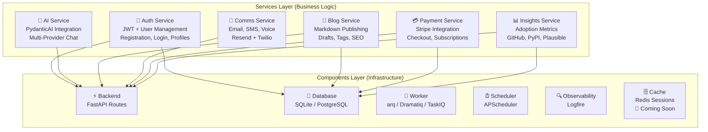
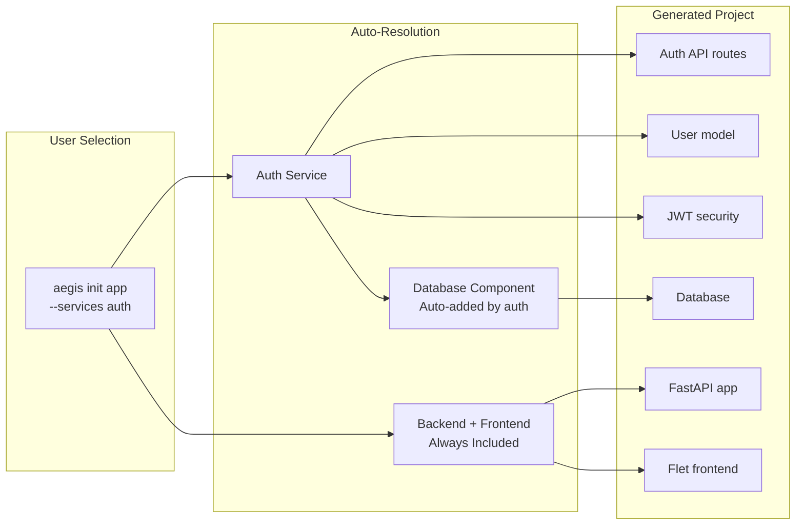
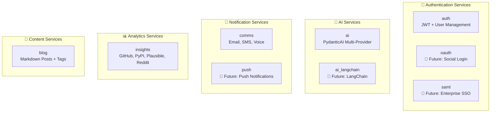
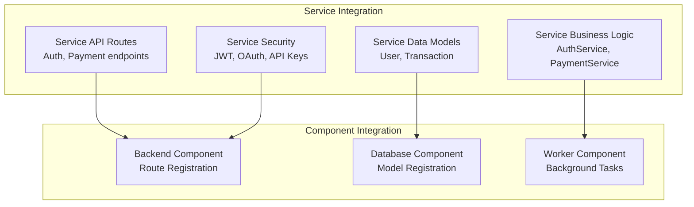

# Services Overview

Services are **business-level functionality** that your application provides to users. While Components handle infrastructure concerns (databases, workers, scheduling), Services implement specific business capabilities like authentication, payments, or AI integrations.

!!! info "Services vs Components"
    **Services** = What your app does (auth, AI, insights)
    **Components** = How your app works (database, workers, API)

## Service Architecture



!!! tip "Architectural Guidance"
    This page covers **which services are available** and how to add them to your project. For detailed patterns on **how services integrate with components** and how to structure your code, see **[Integration Patterns](../integration-patterns.md)**.

## Service Selection

Services are chosen during project creation and automatically include their required components:

```bash
# Basic API project (no services)
aegis init my-api

# Interactive mode - must explicitly specify required components
aegis init user-app --services auth --components database
# Required: must include database component that auth service needs

# Non-interactive mode - must explicitly specify all components
aegis init user-app --services auth --components database --no-interactive
# Required: must include database component that auth service needs

# Multiple services with explicit components (future)
aegis init full-app --services auth,ai --components database,worker --no-interactive
# Required: must include all components that services need
```

## Dependency Resolution

**Interactive Mode:** Services automatically include required components.

**Non-Interactive Mode:** You must explicitly specify all required components when using `--components`.



## Service Categories



## Service Development Patterns

### Service Structure

Every service follows one layout, so the file you want is where you expect it
whoever wrote the service. Names are positional - the file says what it *is*,
not what it is called:

| File | Holds | Part |
|------|-------|------|
| `health.py` | what the dashboard shows | required |
| `queries.py` | every read, batched; no business logic | required once it reads |
| `jobs.py` | all background jobs, each `*_job` in a `JOBS` list or called | required once it has jobs |
| `service.py` | the facade: the entry point callers reach for | optional (advised) |
| `models.py` | the service's tables | optional |
| `schemas.py` | request and response shapes | optional |
| `deps.py` | the request-scoped wiring | optional |
| `tools.py` | what it hands the AI: its chat tools | optional |
| `change_types.py` | what it hands the change queue: its executors | optional |
| `sources.py` | what it hands research: the sources a plugin registers | optional |
| `adapters/` | what it talks to: providers, file formats, collectors, kept apart from what it knows (`domains/`) | optional |
| `constants.py`, `utils.py` | shared values and helpers | optional |

Its router lives apart, in `app/components/backend/api/<name>`, and leaves the
database to the service. At least one test imports the service.

A service grows into that layout in three steps, and stops at whichever one
still fits: a small service keeps its logic in `service.py`; a larger one puts
each subsystem in a package under `domains/`, and what it talks to (a
provider's API, a file format, a source's collector) under `adapters/`, kept
apart from what it knows.

```
app/services/
├── documents/               # a spine, plus one domain
│   ├── service.py models.py queries.py health.py deps.py
│   └── domains/
│       └── extraction/      # pages.py pdf.py vision.py dispatch.py jobs.py
│
└── finance/                 # several domains, each its own package
    ├── service/ models/ schemas/ health.py jobs.py utils.py
    ├── domains/
    │   ├── ledger/          # each with its own queries.py
    │   ├── planning/
    │   └── detection/
    └── adapters/            # what it talks to: providers/, importers/
```

Domains are plural nouns with no `_service` suffix, and their functions take
the session first (`async def create_budget(db, ...)`). Everything a caller
outside the service needs reaches it through `service.py`; the domain packages
are how the service is organised, not its public surface.

The `__init__.py` docstring is the domain map. It is the first thing anyone
reads - a person opening the package or a coding agent deciding where a change
belongs - so it names each domain and what it owns.

!!! tip "The layout is tested, not just described"
    Behavioural tests cannot see a layout: a service works the same whether it
    is one flat package or four small ones. Every service is checked against
    this standard as a pattern: **Overseer > Patterns > Service parts** shows
    which parts each one has and which rules it breaks, with the file and line
    that shows it, and `patterns --format json` prints the same report. The
    enforced rules (reads in queries, every job wired, a health check) are held
    by `tests/services/test_service_layout.py`; reads still outside a queries
    module are recorded there as debt that may only shrink. A module at a
    service's top level that the table above does not name is flagged too
    (**Logic lives in domains**), each loose file listed, and so is a file
    past the size budget (**Files stay readable**): over 500 lines, 900 for
    models, schemas and other lists, or the largest file of its package at
    over 40% of it and 400 lines. On the map, open the Server: a service
    that breaks a rule says how many places to fix, and hovering it lists
    each one (the file linked, its size or its line) with what to do. Open
    the service and each piece says the same about its own files.
    A service that imports another's `domains/`, `adapters/`, `queries` or
    `models` is flagged too (**Other services through their facade**), each
    import's line listed: it depends on how the other is organised, not on
    what it offers. `patterns touches` takes a change's files (as arguments,
    or one per line from `git diff --name-only`) and says, from the app's
    ontology, which parts own them, which parts depend on those, and the
    tables, routes and jobs they define; Markdown for a pull request's job
    summary, JSON with `--format json`.
    Finance and documents also carry a `test_*_module_layout.py` stating which
    module defines what, so folding a domain back together, or dropping a
    function into whichever file was open, fails a test rather than passing
    quietly.

### Service Integration Points



## CLI Commands

### List Available Services
```bash
aegis services
```

Shows all available services by category with their dependencies:

```
AVAILABLE SERVICES
========================================

Authentication Services
----------------------------------------
  auth         - User authentication and authorization with JWT tokens
               Requires components: backend, database

Payment Services
----------------------------------------
  payment      - Payment processing with Stripe (checkout, subscriptions, webhooks)
               Requires components: backend, database

AI & Machine Learning Services
----------------------------------------
  No services available yet.
```

### Create Project with Services
```bash
# With specific services - must include required components
aegis init my-app --services auth --components database

# Interactive service selection
aegis init my-app --interactive

# Multiple services (future)
aegis init full-app --services auth,ai --components database,worker
```

## Dashboard Integration

Services automatically appear in the health dashboard alongside components, providing real-time monitoring of your business capabilities. See **[Overseer](../overseer/index.md)** for dashboard documentation.

---

**Next Steps:**

- **[Integration Patterns](../integration-patterns.md)** - How services integrate with components and architectural patterns
- **[AI Service](ai/index.md)** - Multi-provider chat, database-driven agent registry, memory modules, RAG, sentiment analytics
- **[Authentication Service](auth/index.md)** - Complete JWT auth implementation
- **[Blog Service](blog/index.md)** - Markdown publishing with drafts, tags, and Overseer editor *(experimental)*
- **[Communications Service](comms/index.md)** - Email, SMS, and voice via Resend/Twilio
- **[Documents Service](documents/index.md)** - Content-addressed document store with page-addressed extraction
- **[Insights Service](insights/index.md)** - Adoption metrics tracking (GitHub, PyPI, Plausible, Reddit) *(experimental)*
- **[Payment Service](payment/index.md)** - Payment processing with Stripe *(experimental)*
- **[CLI Reference](../cli-reference.md)** - Service command reference
- **[Components Overview](../components/index.md)** - Infrastructure layer
