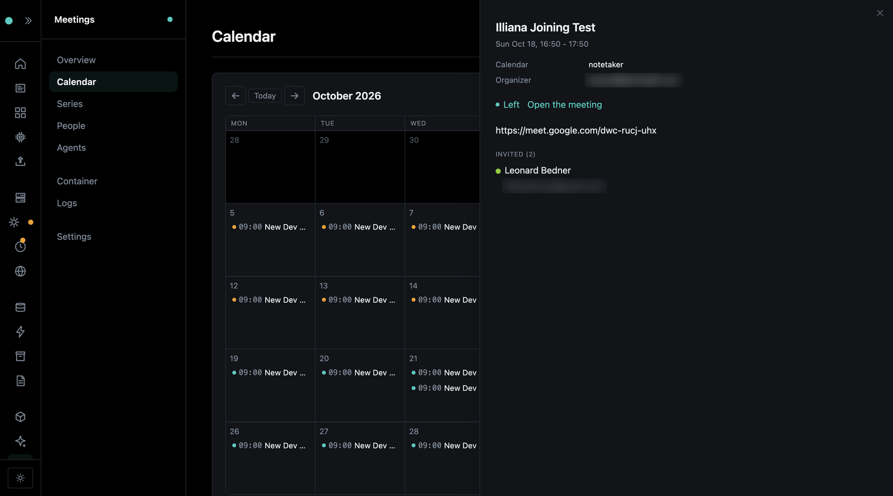

# Agents and Calendars

The bot joins as an **agent**: a Google account of its own, with its own name, sign-in and calendar.

## Sign the bot in

Meet turns away a browser that is not signed in. Make the bot a Google account of its own (never yours), then sign it in once:

```bash
my-app meetings login
```

Chrome opens at Google's sign-in. Sign in as the bot, quit Chrome, and the sign-in is kept, encrypted, in the secrets store. Needs the `secrets` component and an `ENCRYPTION_KEY`. Until then the bot joins as a guest.

## More than one agent

Each agent is its own Google account with its own name in the call, say a work notetaker and a personal one:

```bash
my-app meetings login --agent work --name "Work Notetaker" --email notes@work.example
```

A meeting is sent as the first agent unless another is named. Each agent's picture, **Camera** and **Answers anyone** switches are set on Overseer's Agents tab.

## Invite the agent, it comes

Give an agent its calendar: in its Google Calendar settings, set "Add invitations to my calendar" to "From everyone", then copy the "Secret address in iCal format" into a secret (`MEETINGS_BOT_CALENDAR_SECRET` for the first agent, `MEETINGS_BOT_CALENDAR_SECRET__WORK` for `work`):

```bash
my-app secrets set MEETINGS_BOT_CALENDAR_SECRET
```

{ width="480" }

Now invite the agent's address to a meeting, and it joins about a minute before the start, every time a recurring meeting happens. Turn that off with `MEETINGS_JOIN_FROM_CALENDAR`; the calendar is still shown.

A meeting joined from the calendar is owned by the first person on the invite with an account here, else the agent's default owner (set on the Agents tab).
