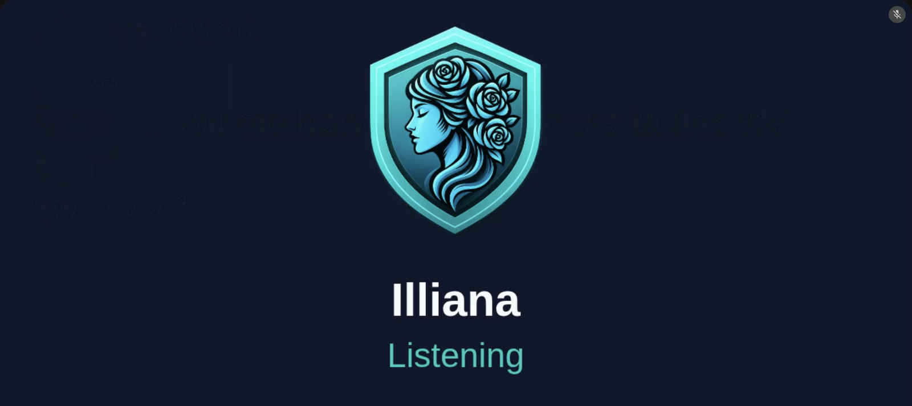

# In the Call

## How the bot runs a meeting

```
requested -> joining -> waiting -> in_call -> left
                           |          |
                           +----------+--> failed (with the reason)
```

1. It opens the meeting in the browser container and asks to join. It waits up to five minutes to be let in.
2. Once in, it turns on Meet's captions (its own view only) and posts in the chat that it is taking notes.
3. It keeps the captions as the transcript: one line per turn, under the speaker's name.
4. It leaves when the call ends, when it is removed, after two minutes alone, or when asked (`meetings leave`, or Leave on the page).

Then the notes are written ([Notes, People and Series](notes.md)).

## Where it runs

`meetings join` runs it in the terminal. The pages and the API hand it to the worker's `meetings` queue, so a webserver restart leaves the call alone; the queue's concurrency is how many calls run at once. Without a worker it runs in the webserver.

A process that dies mid-call is caught by its heartbeat: within a minute the meeting is marked `failed`.

## When Meet changes

Everything the bot knows about Meet's page lives in `app/services/meetings/domains/bot/meet.py`. Each control is found by its label, with Meet's keyboard shortcuts as a fallback. What the bot did with each control is kept on the meeting and shown as an "On Meet" row under its status (*Join · Captions · Chat (by shortcut) · Mic (not found)*), only what went wrong marked, so a renamed button is easy to spot.

## Its card and its voice

The bot's camera tile is a card: its agent's picture (or initials), its name, and what it is doing:

{ width="480" }

| Status | When |
|---|---|
| Listening | the default |
| Can't see captions | Meet offered no captions |
| Question heard | a question was heard and an action on it is waiting |
| Answering | a runner has taken that action |
| Leaving | on its way out |

While Illiana is answering, the card shows the question, what she is looking up, and her answer in brief, with what is next and her last few answers along the foot. Each agent's picture and its **Camera** switch are set on Overseer's Agents tab.

The bot joins with its camera on (unless its Camera switch is off), so its card shows from the first moment; it joins muted, unmutes only to answer, and never speaks to announce itself.

While Illiana works on a question and has said nothing yet, the call hears soft key taps instead of her saying what she is looking up: the same taps as Overseer's voice chat, set by its working sound (`VOICE_WORKING_SOUND`, or the active voice profile).

The bot hears a line put to Illiana as Meet captions it: the page tells the bot within a fraction of a second whenever a caption naming her, a reply to her, or anything said over her moves, so the card follows the words as they are said and a stop takes effect at once. Other talk is picked up on the bot's regular look, every couple of seconds.

## What the bot hears

The bot reads the call's audio, a second at a time, and gives each second to whoever the captions say was talking. When the call ends, how long each speaker was heard is kept ("Heard: Ada 4m 10s · Leonard 2m 30s"). The audio itself is not kept unless `MEETINGS_KEEP_AUDIO_DIR` is set, which keeps a WAV per speaker.
