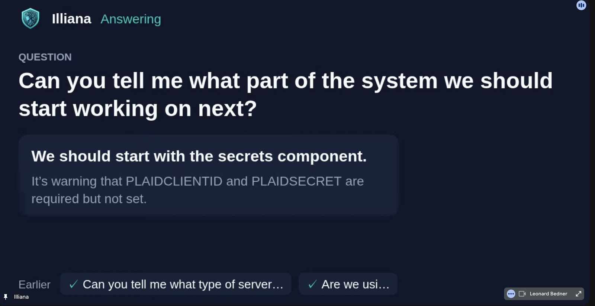

# Talking to Illiana

Say the bot's name and Illiana answers in the call, out loud, with her own prompt, model and tools (the system's twin among them). Needs the AI service on pydantic-ai with a database.

{ width="480" }

## Quick actions

| Say | What she does |
|-----|---------------|
| *Illiana, how many errors in the last hour?* | Answers, short |
| *Illiana, how are the standups going?* | Reads that series and sums it up |
| *Illiana, when did we talk about pricing?* | Searches what was said, and says who |
| *Illiana, tell me more.* / *Which ones?* | Goes as deep as asked |
| *Illiana, stop.* / *Never mind.* / *That's enough.* | Stops at once and drops what she owed |
| Talk over her | Pauses where you cut in |
| *Go ahead, Illiana.* / *Sorry, you were saying?* | Picks up where she was cut off |
| A new question over her | Drops what she kept and answers that |
| A follow-up right after she answers | No name needed |
| *Thanks, Illiana.* | Nothing |

## Who can ask

Only the meeting's owner, unless the agent's **Answers anyone** switch is on (Overseer > Meetings > Agents). Her name is matched loosely, since captions spell it *Iliana* or *Eliana*. Talking about her (*Illiana said it was fine*) is not talking to her.

## How she answers

- **Short by default.** One sentence, with the count, name or time behind it. Ask for more and she goes as deep as you ask.
- **Live** where the stack has a live voice engine: you hear her as she makes the answer. Otherwise she answers in a chat turn and the bot says it a sentence at a time.
- **Her card**: see [Its card and its voice](bot.md#its-card-and-its-voice).
- **The chat** gets every answer too.
- **Earlier meetings** she reads back with one tool, `meetings`: asked nothing, every series' headline and the latest meetings; a series in full (what keeps coming up, what is settled and still open); a meeting in full (its notes and every line said); or a search of the words said. A **Meetings** [context module](../ai/context-modules.md) tells her how to read them; edit it in Overseer > AI > Memory.

Stops, cut-ins and go-ons are kept with the transcript, not listed as moments.
