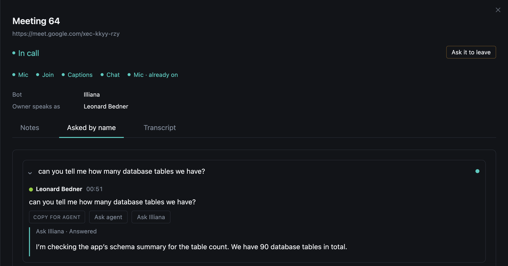

# Questions and Actions

While the bot is in a call it picks out **moments**: things said that something can be done with. Each moment offers **actions**, and each action asked is a **run**.

## Questions

A question asked in the call (not one put to someone in it, like *can you send that over?*) shows up on the meeting's Questions tab while the call is on. Questions asked close together read as one card. After the call, where the stack has a model, they are cleaned up and grouped by topic. **Look over the call again** (or `meetings look-over`) reads an old call over again.

## Actions

| Action | What it does |
|--------|--------------|
| **Copy for agent** | Copies a prompt (the last lines of the call, then the question) to paste into Claude Code, Codex or anything else |
| **Ask agent** | A coding agent on a [runner](#the-runner) answers it from your repository |
| **Ask Illiana** | Illiana answers it in the chat |

{ width="480" }

Each run shows under its question: waiting, answering, then answered or failed. A run claimed and never finished fails after half an hour.

To ask an action of every question as it is heard, set `MEETINGS_AUTO_ACTIONS` (Overseer > Meetings > Settings), for example `question=agent`.

## The runner

The coding agent runs on your machine, not in the app. The runner asks the app for waiting runs, answers each in a fresh worktree of your repository, and posts back what it printed.

```
 "Ask agent"  --->  run: asked
                    POST /runs/claim   <---  runner claims the oldest
                                             fresh worktree of --repo
                                             runs --command
                    POST /runs/{id}/finish <-- posts what it printed
                    run: done | failed
```

```bash
my-app meetings runner-token create laptop
export MEETINGS_RUNNER_TOKEN=mrt_...
my-app meetings runner \
  --url https://my-app.example.com \
  --repo ~/code/my-service \
  --command 'claude -p {prompt} --permission-mode plan'
```

Any headless agent works (`codex exec {prompt}`, `aider --message {prompt}`). A runner answers one run at a time, oldest first; start more to answer more at once. In the dev stack a `meetings-runner` service runs one for you, configured in `.env.meetings-runner`.

## Your own moments and actions

Register them in a `meeting_moments.py` beside any service's `service.py`:

```python
from app.services.meetings.service import Action, register_action, register_detector

register_detector("decision", lambda heard: heard.text if "we decided" in heard.text.lower() else None, title="Decisions")
register_action(Action("ticket", "File a ticket", frozenset({"question"}), "runner"))
```

An action runs in the `browser` (its prompt copied), the `app`, or on a `runner` started with `--action ticket`.
