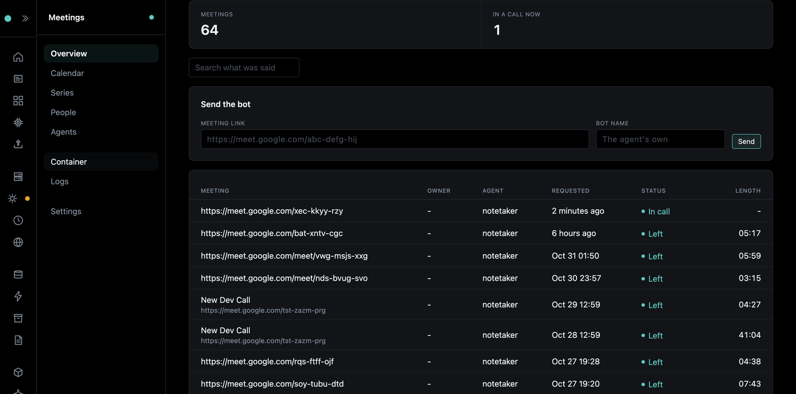
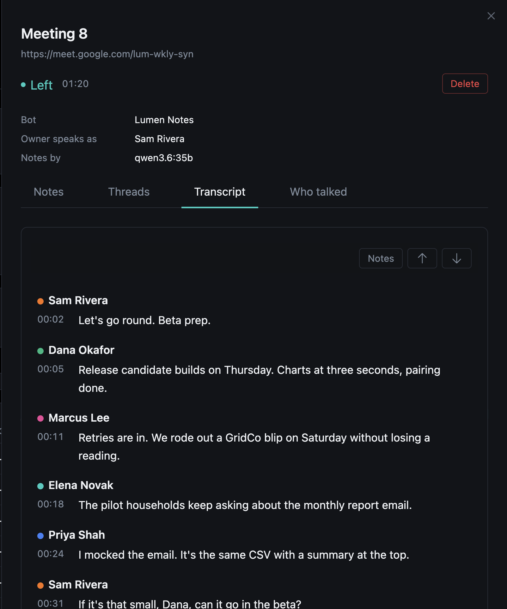
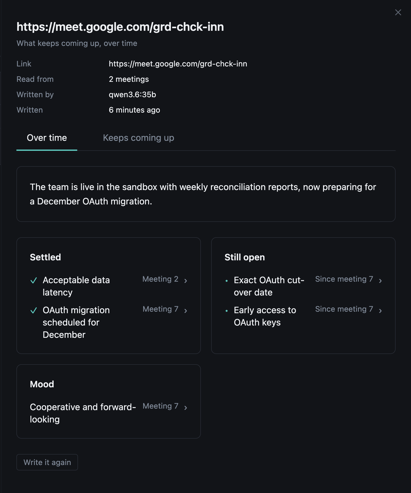

# Meetings Page and Overseer

## The Meetings page

With the htmx frontend, `/meetings` sends the bot and reads what came of it:

- **Meetings** - every meeting, newest first. Paste a link and send the bot.
- **One meeting** - its status live, then the notes, each item linked to its line in the transcript.
- **What's this about?** - on any transcript line, Illiana says what the speaker means, and draws the part of the system it names.
- **Part chips** - a line that names a part of the stack ("the scheduler", "Redis") gets a chip; ask it and Illiana explains that part.
- **Questions** - the call's questions and their actions. See [Questions and Actions](moments.md).
- **Which speaker is you** - picks your action items.
- **Calendar** - a month of the agents' calendars.

With auth, each user sees only their own meetings.

## In Overseer

Overseer > Services > Meetings does the same across every owner:

- **Overview** - how many meetings and how many in a call now, search, send the bot, and every meeting; a row opens it in the drawer: notes, transcript, threads, Leave, Delete.
- **Calendar** - every agent's month.
- **Series** and **People** - what keeps coming up, and each person's guide.
- **Agents** - each agent's sign-in, picture, switches and default owner.
- **Container** and **Logs** - the service's container and its logs.
- **Settings** - the join announcement, joining from the calendar, auto actions, and where audio is kept.

{ width="480" }

{ width="480" }

{ width="480" }

The Flet dashboard (`/dashboard`) has the same in its Meetings modal.

## Search

Every word said, and every part of the notes, is searchable from the page, Overseer and the API. It matches words in their other forms ("pricing" finds "priced"), not meaning. Overseer's chat searches too, with the `meetings_search` tool.
